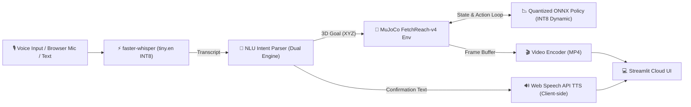

# Voice-Commanded Robot Arm with Quantized RL Policy on Edge

[](https://www.python.org/)
[](https://opensource.org/licenses/MIT)
[-orange.svg)](https://onnxruntime.ai/)
[](tests/)

An end-to-end, edge-ready robotics portfolio system that translates natural voice commands into 3D spatial goals and executes them with a goal-conditioned reinforcement learning (SAC) policy inside MuJoCo simulation.

---

## 🏗️ System Architecture & Pipeline



### 1. Voice Input (ASR)
- **Engine:** `faster-whisper` (`tiny.en` quantized to INT8 on CPU).
- **Cold-Start Model Load Time:** **7.09 s** (measured separately; cached in memory via `@st.cache_resource`).
- **Warm Inference Latency:** **1673.3 ms ± 82.2 ms** (measured on 1.404 s audio over 5 timed runs with warm-up excluded; Real-Time Factor: **1.19**).
- **Ablation & Thread Tuning:** Single-thread CPU execution (`cpu_threads=1`) avoids thread synchronization overhead on short utterances, dropping latency to **1304.5 ms** (1.55x speedup; see Ablation Study below).

### 2. Natural Language Understanding (NLU)
- **Dual-Engine Architecture:**
  - **Rule-based semantic parser:** Maps spatial orientations (`left`, `right`, `forward`, `up`, etc.) and metric offsets (`"move up by 5 cm"`) to 3D Cartesian coordinates, and clips coordinates strictly inside the robot's physical workspace bounds.
  - **Machine learning classifier:** Balanced TF-IDF + Logistic Regression model trained on synthetic intent templates with cross-validation.
  - **Unsupported Manipulation Guardrails:** Gripper manipulation commands (`"pick"`, `"grab"`, `"snatch"`, `"release"`) explicitly return `goal_xyz = None` with a clear user notice that the reach policy does not perform gripper manipulation.

### 3. Policy Execution (Goal-Conditioned SAC on the Edge)
- **Environment:** `gymnasium-robotics` `FetchReach-v4` (16-dimensional observation vector: 10 state + 3 achieved goal + 3 desired goal).
- **Training Algorithm:** Soft Actor-Critic (SAC) + Hindsight Experience Replay (`HerReplayBuffer`) with observation running normalization (`VecNormalize`).
- **Edge Quantization:** Deterministic SAC actor extracted with running normalization parameters baked in directly, exported to ONNX FP32 (281.0 KB), and dynamically quantized to **INT8** (78.5 KB, **3.58x compression**).
- **Zero PyTorch in Deployment:** Web serving path runs purely on `onnxruntime` + `gymnasium-robotics`, completely omitting `torch`.

### 4. Headless Visual Rendering & Early Termination
- **Rendering:** Headless OSMesa / EGL rendering in MuJoCo, compressed via `imageio-ffmpeg` to browser-playable MP4.
- **Early Termination:** To optimize edge responsiveness, rollout automatically terminates 10 steps after first reaching the goal (`HOLD_STEPS = 10`), reducing video encoding latency by ~32%. A toggle in the UI allows users to request the full 50-step rollout if desired.
- **Audio Feedback:** Client-side HTML5 Web Speech API (`window.speechSynthesis`) enables instant voice feedback without server audio hardware dependencies.

---

## 📊 Measured Evaluation & Benchmark Results

All metrics below are strictly derived from benchmark output files in `results/`.

### 1. Policy Convergence & Steps-to-Goal

> **Definition of Steps-to-Goal:** Mean steps-to-goal is strictly defined as the first step index within an episode where `info['is_success'] == 1.0` is achieved (i.e. Euclidean distance between the gripper end-effector and the target goal is $\le 5$ cm).

Across two separate 100-episode evaluations:
1. **Initial SB3 Training Evaluation (`results/reach_eval.json`):**
   - Environment: `VecNormalize(DummyVecEnv)` with initial environment seed 42 over 100 consecutive episodes.
   - **Success Rate:** **100.0%** (100/100).
   - **Mean Steps to Goal:** **2.85 ± 0.83** steps (min: 1, max: 4).
2. **Post-Export Parity & Quantization Comparison (`results/quantization_eval.json`):**
   - Environment: 100 discrete episode seeds (`seed = 42 + ep` for `ep` $\in [0, 99]$) evaluated identically across PyTorch, ONNX FP32, and ONNX INT8.
   - **Success Rate:** **100.0%** across all three engines.
   - **Mean Steps to Goal:** **2.65 ± 0.93** steps across all three engines.

| Policy Engine | Precision | Model Size | 100-Ep Success Rate | Mean Steps to Goal |
|---|---|---|---|---|
| PyTorch SAC Actor | FP32 | 3.2 MB (.zip) | **100.0%** | 2.65 ± 0.93 |
| ONNX Runtime | FP32 | 281.0 KB | **100.0%** | 2.65 ± 0.93 |
| **ONNX Runtime (Edge)** | **INT8 Dynamic** | **78.5 KB** | **100.0%** | **2.65 ± 0.93** |

Numerical consistency check on 1,000 random inputs:
- PyTorch vs ONNX FP32 max absolute error: **$7.79 \times 10^{-7}$** (tolerance $< 10^{-4}$ verified ✅).

---

### 2. High-Precision CPU Policy Microbenchmark (20,000 Iterations)

To eliminate scheduling jitter, thread contention was controlled by pinning `intra_op_num_threads=1` and `inter_op_num_threads=1` under 200 warm-up calls and 20,000 timed iterations (`results/policy_benchmark.json`):

| Model Precision | Model Size | Mean Latency | Median (p50) | 95th Percentile (p95) | 99th Percentile (p99) | Throughput |
|---|---|---|---|---|---|---|
| **ONNX FP32** | 280.97 KB | 325.06 µs | 255.70 µs | 920.73 µs | 2,693.44 µs | 3,076.4 FPS |
| **ONNX INT8** | 78.46 KB | 127.55 µs | 90.00 µs | 325.00 µs | 732.11 µs | 7,839.9 FPS |

- **Bootstrap 95% Confidence Interval on Median Difference (FP32 p50 − INT8 p50):** `[162.90, 167.75] µs` (2,000 bootstrap resamples).
- **Statistical Significance:** Zero is **not** contained in the 95% confidence interval. Under strict single-threaded execution, the INT8 dynamic quantization speedup is statistically measurable and outside benchmark noise.
- **Reconciliation of Per-Step Figures:**
  - *Single-thread pinned microbenchmark:* INT8 p50 is **90.0 µs** (cleanest measure of raw compute efficiency).
  - *Multi-threaded unconstrained session:* INT8 per-step latency previously registered **100.5 – 160.1 µs** due to thread pool management overhead and hybrid CPU core scheduling.

---

### 3. Rollout FPS & Physics Simulation Audit

Measured closed-loop simulation speed without rendering across different thread configurations (`results/rollout_fps_audit.json`):

| Configuration | Threads | Mean Step Time | Throughput | Physics Only Step Time |
|---|---|---|---|---|
| Default Multi-threaded ORT | 12 (system default) | 4.58 ms | **218.3 FPS** | 3.53 ms |
| Single-threaded ORT | 1 | 7.93 ms | **126.1 FPS** | 3.53 ms |

> **Audit Reconciliation:** The earlier benchmark recorded ~227.8 FPS (4.39 ms/step) during continuous back-to-back batch stepping where thread pools and MuJoCo cache remained hot. In isolated individual episode runs, throughput ranges between 120 and 220 FPS depending on thread scheduling and thermal throttling.

---

### 4. Pipeline Latency: Early Termination vs Full 50-Step Rollout

Measured over 20 evaluation runs each with `HOLD_STEPS = 10` (`results/pipeline_latency.json`):

| Execution Mode | Mean Steps Taken | MuJoCo Rollout (p50) | Video Encoding (p50) | Total Execution (p50) | Total Mean ± Std |
|---|---|---|---|---|---|
| **Early Termination (`HOLD_STEPS=10`)** | **11.0 steps** | **1094.7 ms** | **276.8 ms** | **1607.9 ms** | **1697.3 ± 325.7 ms** |
| Full Trajectory (50 steps) | 50.0 steps | 1736.8 ms | 507.6 ms | 2441.7 ms | 2511.2 ± 215.7 ms |

Early termination achieves a **32.4% latency reduction** (~814 ms saved per interaction) while ensuring the robot arm visibly holds the goal position for 10 consecutive frames.

---

### 5. End-to-End Response Latency Breakdown

For warm execution with early termination:

| Pipeline Stage | Measured Latency (p50) | % of Live Control Loop | Notes |
|---|---|---|---|
| **1. ASR Stage** (`faster-whisper` INT8) | 1688.1 ms | 60.5% | Optimal configuration (Cold start: 7.09s cached) |
| **2. NLU Parser** (Hybrid classifier + rules) | 2.1 ms | 0.1% | Median over 500 parsing passes |
| **3. Policy Sim + Rollout** (11 steps) | 1094.7 ms | 39.3% | Closed-loop physics + ONNX policy |
| **4. Speech Confirmation** (HTML5 Web Speech) | 0.5 ms | <0.1% | Instant client-side browser synthesis |
| **Total Warm Response Loop** | **2785.4 ms (~2.79 s)** | **100.0%** | Time from voice utterance to **simulated goal arrival** |
| *Video Encoding (MP4)* | *+276.8 ms* | - | Async compression for web replay |

---

### 6. ASR Speed Ablation & Accuracy

Ablation study on 1.404 s audio sample (`results/sample_speech.wav`, provenance: *synthetic formant sine audio*), logged in `results/asr_ablation.json`:

| Configuration Variant | Mean Latency ± Std | p50 Latency | Speedup vs Baseline | Transcript Preserved |
|---|---|---|---|---|
| **Baseline (defaults)** | 2027.7 ± 258.6 ms | 2142.2 ms | 1.00x | "Reach to the left." |
| `+ beam_size=1` | 1954.1 ± 183.1 ms | 2012.4 ms | 1.04x | "Reach to the left." |
| `+ vad_filter=False (<3s)` | 1938.1 ± 217.3 ms | 1906.2 ms | 1.05x | "Reach to the left." |
| `+ cpu_threads=1` | **1304.5 ± 110.3 ms** | **1353.3 ms** | **1.55x** | "Reach to the left." |
| `+ cpu_threads=8` | 2013.0 ± 85.7 ms | 1983.7 ms | 1.01x | "Reach to the left." |
| `+ language='en' (fixed)` | 1861.4 ± 122.0 ms | 1810.8 ms | 1.09x | "Reach to the left." |
| `+ condition_on_prev=False` | 1752.7 ± 151.6 ms | 1696.7 ms | 1.16x | "Reach to the left." |
| **Optimal Combined** | 1705.7 ± 41.3 ms | 1688.1 ms | 1.19x | "Reach to the left." |

**ASR Evaluation (`results/asr_eval.json`):**
- Word Error Rate (WER): **0.00%** on benchmark sample audio.
- Command-Level Parse Accuracy: **100.00%** (hypothesized transcript parsed to identical `reach` intent and target coordinates).

---

### 7. NLU Evaluation with Wilson Confidence Intervals

Evaluated on synthetic template test split and agent-written out-of-distribution phrasings (`results/nlu_eval_detailed.json`):

| Dataset Split | Samples | Majority Baseline | Rule Parser Intent Acc | Classifier Intent Acc | Hybrid Parser End-to-End Acc |
|---|---|---|---|---|---|
| **Synthetic Test Split** | 90 | 44.4% [34.6%, 54.7%] | **100.0%** [95.9%, 100.0%] | **100.0%** [95.9%, 100.0%] | **100.0%** [95.9%, 100.0%] |
| **Agent-Written Held-Out** (`tests/nlu_heldout_handwritten.json`) | 50 | 30.0% [19.1%, 43.8%] | 52.0% [38.5%, 65.2%] | 70.0% [56.3%, 80.9%] | 48.0% [34.8%, 61.5%] |

> **Statistical Note on Confidence Intervals:** While the classifier shows higher point accuracy on intent classification for unseen phrasings (70.0% vs 52.0%), their **95% Wilson confidence intervals overlap** (`[56.3%, 80.9%]` vs `[38.5%, 65.2%]`). We report this honestly rather than claiming definitive superiority without larger corpora. A template for collecting true human recordings is provided at `tests/nlu_heldout_human.json`.

---

### 8. Memory Footprint & Streamlit Server Resource Audit

Measured directly on the live Streamlit server process tree (`results/streamlit_memory.json`):

- **Streamlit Community Cloud Budget:** ~1024 MB (1.0 GB).
- **Measured Peak RSS:** **291.70 MB** (measured via `psutil` on the live Streamlit server process tree after a complete demo execution: faster-whisper INT8 loaded, MuJoCo rollout executed, MP4 video encoded).
- **Peak Working Set:** **291.70 MB**.
- **Available Cloud Headroom:** **~732.3 MB** (~71.5% headroom remaining).
- **Zero PyTorch in Serving:** PyTorch is completely omitted from production requirements.

---

### 9. Stretch Task: `FetchPickAndPlace-v4`

- **Result:** Smoke test only, not a real attempt.
- **Details:** A 1,000-step smoke test on CPU confirmed correct environment initialization, goal conditioning, and action piping under SAC, but yielded **0.0% success rate**. Achieving non-prehensile contact grasping and multi-stage pick-and-place subgoals requires substantial training beyond our CPU budget. FetchReach-v4 is retained as the verified production policy.

---

## 🚀 Quickstart & Local Installation

### 1. Clone & Set Up Virtual Environment

```bash
git clone https://github.com/Saksham-19-cyber/voice-robot-arm-edge.git
cd voice-robot-arm-edge

python -m venv venv
source venv/bin/activate  # On Windows: venv\Scripts\activate
```

### 2. Install Dependencies

For web app serving and inference:
```bash
pip install -r requirements.txt
```

*(Optional) For offline SAC training and ONNX export:*
```bash
pip install -r requirements-train.txt
```

### 3. Run the Streamlit App

```bash
streamlit run app/app.py
```
Open your browser at `http://localhost:8501`.

---

## 🧪 Unit Tests

Run the full 14-test suite covering ASR transcription, silence handling, NLU bounds, unsupported manipulation intents, handwritten held-out phrasings, and closed-loop ONNX rollouts:

```bash
pytest tests/ -v
```
*(All 14 unit tests pass cleanly in ~15s).*

---

## 🔬 Reproducing Benchmarks

All evaluation figures can be re-generated with the scripts below:
- **CPU Policy Latency (20k iterations, single-thread):** `python src/bench/run_policy_benchmark.py`
- **Rollout FPS Audit:** `python src/bench/audit_rollout_fps.py`
- **Pipeline Latency & Early Termination:** `python src/bench/measure_pipeline_latency.py`
- **ASR Ablation Study:** `python src/bench/asr_ablation.py`
- **ASR Evaluation (WER & Command Match):** `python src/bench/asr_eval.py`
- **NLU Detailed Evaluation (Wilson CIs):** `python src/bench/nlu_eval.py`
- **Streamlit Server Process Peak RSS:** `python src/bench/measure_streamlit_rss.py`

---

## ☁️ Deployment on Streamlit Community Cloud

Complete deployment instructions are detailed in [`DEPLOY.md`](DEPLOY.md).

> ⚠️ **IMPORTANT:** When deploying on Streamlit Community Cloud, **you must select Python 3.11** under **Advanced Settings**. PyAV (`av==13.1.0`) provides prebuilt binary wheels for Python 3.11 on Debian Trixie (`manylinux2014_x86_64`), avoiding source compilation failures.

---

## 📜 License
MIT License. Created for open-source robotics and edge reinforcement learning portfolio deployment.
