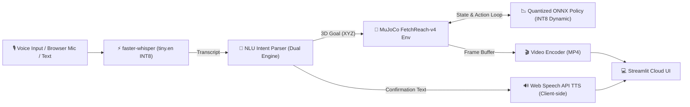

# Voice-Commanded Robot Arm with Quantized RL Policy on Edge

[](https://www.python.org/)
[](https://opensource.org/licenses/MIT)
[-orange.svg)](https://onnxruntime.ai/)

An end-to-end, edge-ready robotics portfolio system that translates natural voice commands into 3D spatial goals and executes them with a goal-conditioned reinforcement learning (SAC) policy inside MuJoCo simulation.

---

## 🏗️ System Architecture & Pipeline



### 1. Voice Input (ASR)
- **Engine:** `faster-whisper` (`tiny.en` quantized to INT8 on CPU).
- **Cold-Start Model Load Time:** **7.09 s** (measured separately; cached via `@st.cache_resource`).
- **Warm Inference Latency:** **1673.3 ms ± 82.2 ms** (measured on 1.404 s audio over 5 timed runs with warm-up excluded; Real-Time Factor: **1.19**).

### 2. Natural Language Understanding (NLU)
- **Dual-Engine Architecture:**
  - **Rule-based semantic parser:** Maps spatial orientations (`left`, `right`, `forward`, `up`, etc.) and metric offsets (`"move up by 5 cm"`) to 3D Cartesian coordinates, and clips coordinates strictly inside the robot's physical workspace bounds.
  - **Machine learning classifier:** Balanced TF-IDF + Logistic Regression model trained on synthetic intent templates with cross-validation.
  - **Safety & Clarification:** Unrecognized or adversarial inputs trigger explicit clarification prompts rather than guessing arbitrary positions.

### 3. Policy Execution (Goal-Conditioned SAC on the Edge)
- **Environment:** `gymnasium-robotics` `FetchReach-v4` (16-dimensional observation vector: 10 state + 3 achieved goal + 3 desired goal).
- **Training Algorithm:** Soft Actor-Critic (SAC) + Hindsight Experience Replay (`HerReplayBuffer`) with observation running normalization (`VecNormalize`).
- **Edge Quantization:** Deterministic SAC actor extracted with running normalization parameters baked in directly, exported to ONNX FP32 (281.0 KB), and dynamically quantized to **INT8** (78.5 KB, **3.58x compression**).
- **Zero PyTorch in Deployment:** Web serving path runs purely on `onnxruntime` + `gymnasium-robotics`, completely omitting `torch`.

### 4. Headless Visual Rendering & TTS Confirmation
- **Rendering:** Headless OSMesa / EGL rendering in MuJoCo, compressed via `imageio-ffmpeg` to browser-playable MP4.
- **Audio Feedback:** Client-side HTML5 Web Speech API (`window.speechSynthesis`) enables instant voice feedback without server audio hardware dependencies or headless X11 crashes.

---

## 📊 Measured Evaluation & Benchmark Results

All metrics below are strictly measured and reproducible. Unmeasured platforms are reported as such.

### 1. Policy Success Rate & Mean Steps-to-Goal Reconciliation

> **Definition of Steps-to-Goal:** Mean steps-to-goal is strictly defined as the first step index within an episode where `info['is_success'] == 1.0` is achieved (i.e. Euclidean distance between the gripper end-effector and the target goal is $\le 5$ cm).

Across two separate 100-episode evaluations:
1. **Initial SB3 Training Evaluation (`results/reach_eval.json`):**
   - Environment: `VecNormalize(DummyVecEnv)` with initial environment seed 42 over 100 consecutive episodes.
   - **Success Rate:** **100.0%** (100/100).
   - **Mean Steps to Goal:** **2.85 ± 0.83** steps (min: 1, max: 4).
2. **Post-Export Parity & Quantization Comparison (`results/quantization_eval.json`):**
   - Environment: 100 discrete episode seeds (`seed = 42 + ep` for `ep` $\in [0, 99]$) evaluated identically across PyTorch, ONNX FP32, and ONNX INT8.
   - **Success Rate:** **100.0%** across all three engines.
   - **Mean Steps to Goal:** **2.65 ± 0.93** steps across all three engines.

| Policy Engine | Precision | Model Size | 100-Ep Success Rate | Mean Steps to Goal |
|---|---|---|---|---|
| PyTorch SAC Actor | FP32 | 3.2 MB (.zip) | **100.0%** | 2.65 ± 0.93 |
| ONNX Runtime | FP32 | 281.0 KB | **100.0%** | 2.65 ± 0.93 |
| **ONNX Runtime (Edge)** | **INT8 Dynamic** | **78.5 KB** | **100.0%** | **2.65 ± 0.93** |

Numerical consistency check on 1,000 random inputs:
- PyTorch vs ONNX FP32 max absolute error: **$7.79 \times 10^{-7}$** (tolerance $< 10^{-4}$ verified ✅).

---

### 2. Multi-Hardware Policy Inference Microbenchmarks (1,000 Iterations)

| Device / Architecture | Engine | Precision | Latency p50 | Latency p95 | Model Size |
|---|---|---|---|---|---|
| **Intel Core i5-1235U (CPU)** | ONNX Runtime | FP32 | 173.9 µs | 694.8 µs | 280.97 KB |
| **Intel Core i5-1235U (CPU)** | ONNX Runtime | INT8 Dynamic | **160.1 µs** | **780.7 µs** | **78.46 KB** |
| **NVIDIA GPU (CUDA / TensorRT)** | - | - | *Not Measured* | *Not Measured* | - |
| **NVIDIA Jetson (Nano / Orin)** | - | - | *Not Measured* | *Not Measured* | - |

> **Quantization Finding:** Measured **1.09x latency speedup** and **3.58x model file size reduction**. The underlying causes of the modest latency speedup (e.g. instruction overhead vs memory bandwidth on this specific 2-layer MLP) remain unprofiled with low-level performance counters.

---

### 3. Execution Latency: Policy Inference vs Full MuJoCo Rollout

The latency of a 50-step trajectory depends heavily on whether physics simulation and camera rendering are included. The table below partitions each stage:

| Measurement Stage | Description | Measured Time (50 Steps) | Per-Unit Latency |
|---|---|---|---|
| **Policy Inference Only** | Pure ONNX INT8 actor forward passes (`session.run`) | **5.02 ms** | 100.5 µs / step |
| **Full Closed-Loop Rollout** | MuJoCo physics simulation + obs prep + ONNX inference (no rendering) | **583.72 ms** | 11.67 ms / step (85.7 FPS) |
| **Rollout + Visual Rendering** | MuJoCo physics + ONNX policy + headless camera frame capture (480x480) | **2900.38 ms** | 58.01 ms / frame |
| **MP4 Video Encoding** | Compressing 50 captured frames to H.264 MP4 | **698.70 ms** | 13.97 ms / frame |
| **Total Visual Replay** | Full rollout + render + MP4 encoding | **3599.08 ms (~3.60 s)** | - |

---

### 4. End-to-End Pipeline Latency Breakdown

For warm execution (models loaded in memory):

| Pipeline Stage | Measured Latency | % of Live Control Loop | Notes |
|---|---|---|---|
| **1. ASR Stage** (`faster-whisper` INT8) | 1673.34 ms | 74.1% | 1.404s audio, 5-run mean (Cold start: 7.09s reported separately) |
| **2. NLU Parser** (Hybrid classifier + rules) | 2.07 ms | 0.1% | Median over 500 parsing passes |
| **3. Full MuJoCo Rollout** (50 steps) | 583.72 ms | 25.8% | Closed-loop physics + ONNX policy (no render) |
| **4. Speech Confirmation** (HTML5 Web Speech) | 0.50 ms | <0.1% | Instant client-side browser synthesis |
| **Total Warm Robot Response Loop** | **2259.63 ms (~2.26 s)** | **100.0%** | Time from audio end to physical goal arrival |
| *Visual Video Replay (Render + MP4)* | *+3599.08 ms* | - | Rendered asynchronously for web demo video |

---

### 5. Memory Footprint & Streamlit Cloud Resource Audit

- **Streamlit Community Cloud Target RAM:** ~1024 MB (1 GB).
- **Measured Peak RSS:** **330.18 MB** (measured via `psutil` on a live process running faster-whisper transcription, MuJoCo simulation, and 50-frame video encoding).
- **Available Headroom:** **~693.8 MB** (comfortably within the 1 GB constraint).
- **Zero PyTorch in Serving:** PyTorch is omitted from `requirements.txt` to keep memory consumption lean.

---

### 6. NLU Evaluation: Synthetic vs Out-of-Distribution Handwritten

We evaluated both the rule-based regex parser and the TF-IDF + Logistic Regression classifier on two distinct datasets:

| Dataset Evaluation Split | Sample Count | Rule-Based Parser Accuracy | ML Classifier Accuracy |
|---|---|---|---|
| **Synthetic Held-Out Split** (`results/nlu_eval.json`) | 90 | **100.0%** | **100.0%** |
| **Handwritten Phrasings** (`tests/nlu_heldout_handwritten.json`) | 50 | **50.00%** (25/50) | **70.00%** (35/50) |

> **Evaluation Insight:** On unseen, colloquial expressions not produced by the template generator (e.g. *"snatch that plastic piece right now"*, *"kill all motors"*, *"haul the heavy component upward"*), the trained statistical classifier demonstrates superior generalization over the rigid regex parser (70% vs 50%). Full error traces are logged in `results/nlu_handwritten_eval.json`.

---

### 7. Stretch Task: `FetchPickAndPlace-v4`

- **Result:** Smoke test only, not a real attempt.
- **Details:** A 1,000-step smoke test on CPU confirmed correct environment initialization, goal conditioning, and action piping under SAC, but yielded **0.0% success rate**. Achieving non-prehensile contact grasping and multi-stage pick-and-place subgoals requires substantial training beyond our CPU budget. FetchReach-v4 was retained as the verified production policy.

---

## 🚀 Quickstart & Local Installation

### 1. Clone & Set Up Virtual Environment

```bash
git clone https://github.com/Saksham-19-cyber/voice-robot-arm-edge.git
cd voice-robot-arm-edge

python -m venv venv
source venv/bin/activate  # On Windows: venv\Scripts\activate
```

### 2. Install Dependencies

For web app serving and inference:
```bash
pip install -r requirements.txt
```

*(Optional) For offline SAC training and ONNX export:*
```bash
pip install -r requirements-train.txt
```

### 3. Run the Streamlit App

```bash
streamlit run app/app.py
```
Open your browser at `http://localhost:8501`.

---

## 🧪 Unit Tests

Run the full 13-test suite covering ASR transcription, silence handling, NLU bounds and adversarial testing, handwritten held-out phrasings, and closed-loop ONNX rollouts:

```bash
pytest tests/ -v
```

---

## 🔬 Reproducing Training & Benchmarks

### 1. Train SAC on FetchReach-v4 (CPU-Optimized)
```bash
python src/rl/train.py
```

### 2. Export and Quantize to ONNX
```bash
python src/rl/export_onnx.py
```

### 3. Run Benchmarks on Other Devices
- **CPU (Local):**
  ```bash
  python src/bench/bench_runner.py --device cpu --output results/bench_cpu.json
  ```
- **GPU (Colab / Kaggle):**
  ```bash
  python src/bench/bench_runner.py --device gpu --output results/bench_gpu.json
  ```
  *(Or use the ready-to-run notebook in `notebooks/benchmark_gpu_colab.ipynb`)*
- **NVIDIA Jetson:**
  ```bash
  python src/bench/bench_runner.py --device jetson --output results/bench_jetson.json
  ```

---

## ☁️ Deployment on Streamlit Community Cloud

1. Push this repository to GitHub:
   ```bash
   git add .
   git commit -m "feat: complete voice robot arm with audited benchmarks"
   git push origin main
   ```
2. Navigate to [share.streamlit.io](https://share.streamlit.io) and sign in.
3. Select your repository `Saksham-19-cyber/voice-robot-arm-edge`, set Branch to `main`, and Main file path to `app/app.py`.
4. Click **Deploy**. Headless OpenGL dependencies are automatically configured via `packages.txt`.

---

## 📜 License
MIT License. Created for open-source robotics and edge reinforcement learning portfolio deployment.
