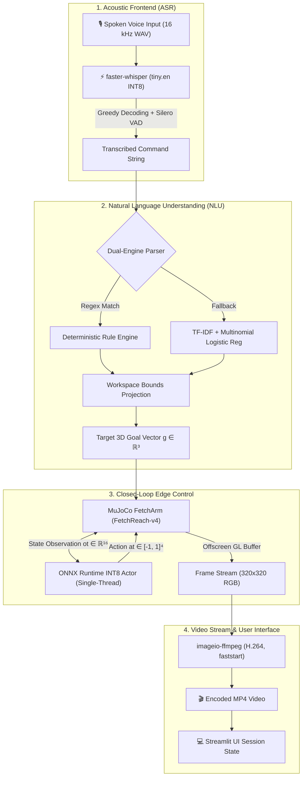

# Voice-Commanded Robot Arm with Quantized RL Policy on Edge

[](https://voice-robot-arm-edge-48q2t6rryznf97ypfkd59k.streamlit.app/)
[](https://www.python.org/)
[](https://opensource.org/licenses/MIT)
[-orange.svg)](https://onnxruntime.ai/)
[](tests/)

🔗 **Live Production Deployment:** [voice-robot-arm-edge-48q2t6rryznf97ypfkd59k.streamlit.app](https://voice-robot-arm-edge-48q2t6rryznf97ypfkd59k.streamlit.app/)

<!-- Placeholder for live Streamlit Cloud app screenshot: see assets/screenshots/ADD_CLOUD_SCREENSHOT.txt -->


An end-to-end, edge-optimized robotics system translating spoken English voice commands into 3D Cartesian coordinates and executing closed-loop trajectory reaching via a Soft Actor-Critic (SAC) reinforcement learning policy inside MuJoCo physics. 

Designed specifically for constrained edge deployments, the production serving stack eliminates the PyTorch runtime dependency entirely (`Zero-PyTorch`), serving 8-bit dynamically quantized ONNX models alongside INT8 `faster-whisper` speech recognition in **185.59 MB peak resident memory** under Linux OSMesa headless rendering.

---

## 📑 Table of Contents
1. [System Architecture & Dataflow](#-system-architecture--dataflow)
2. [Reinforcement Learning & Control Theory](#-reinforcement-learning--control-theory)
3. [Quantization & Edge Optimization Mechanics](#-quantization--edge-optimization-mechanics)
4. [Acoustic Speech Recognition & Hybrid NLU](#-acoustic-speech-recognition--hybrid-nlu)
5. [Key Empirical Benchmark Findings](#-key-empirical-benchmark-findings)
6. [Empirical Visualizations](#-empirical-visualizations)
7. [Comprehensive Measurement Tables](#-comprehensive-measurement-tables)
8. [Edge Serving & Runtime Architecture](#-edge-serving--runtime-architecture)
9. [Quickstart & Verification](#-quickstart--verification)
10. [Scientific Scope & Boundary Conditions](#-scientific-scope--boundary-conditions)
11. [Extended Documentation](#-extended-documentation)

---

## 🏗️ System Architecture & Dataflow

The inference pipeline maps streaming audio bytes to encoded video frames across four modular, decoupled stages:



### Stage Latency Breakdown (Warm Request)
- **Acoustic ASR (`faster-whisper`):** 1639.9 ms p50 on 2.0s audio clip (`cpu_threads=1`).
- **NLU Intent & Goal Extraction:** 3.27 ms p50 via regex extraction with TF-IDF fallback.
- **Rollout Simulation & Render:** 34.9 ms p50 (13.0 steps average with early termination).
- **H.264 Video Encoding:** 329.3 ms p50 via `imageio-ffmpeg` with `-movflags +faststart`.
- **Total End-to-End User Wait Time:** 1597.6 ms median across 5 runs (single-run: 2008.5 ms p50).

---

## 📐 Reinforcement Learning & Control Theory

The robotic reaching task is framed as a Goal-Conditioned Markov Decision Process (GCMDP) defined by the tuple $\mathcal{M} = \langle \mathcal{S}, \mathcal{A}, \mathcal{G}, \mathcal{P}, \mathcal{R}, \gamma \rangle$.

### 1. State, Goal & Action Spaces
- **Observation Vector:** $s_t \in \mathbb{R}^{10}$, consisting of 3D gripper position $x_{\text{gripper}} \in \mathbb{R}^3$, 3D gripper linear velocity $\dot{x}_{\text{gripper}} \in \mathbb{R}^3$, and gripper finger joint positions/velocities $q_f, \dot{q}_f \in \mathbb{R}^4$.
- **Achieved Goal:** $x_{\text{achieved}} \in \mathbb{R}^3$, the current 3D Cartesian coordinates of the end-effector.
- **Desired Goal:** $g \in \mathbb{R}^3$, the target Cartesian coordinates requested by the voice command.
- **Policy Input Representation:** Concatenated state vector:
  $$o_t = [s_t, x_{\text{achieved}}, g] \in \mathbb{R}^{16}$$
- **Action Space:** $a_t \in [-1, 1]^4$, representing continuous Cartesian displacement velocity commands $(\Delta x, \Delta y, \Delta z)$ and gripper finger actuator effort.

### 2. Maximum Entropy Soft Actor-Critic (SAC) Formulation
The policy is trained under the maximum entropy RL objective, maximizing both expected task reward and policy entropy:
$$J(\pi) = \sum_{t=0}^T \mathbb{E}_{(s_t, a_t) \sim \rho_\pi} \left[ r(s_t, a_t, g) + \alpha \mathcal{H}(\pi(\cdot \mid s_t, g)) \right]$$

where the entropy term is defined as:
$$\mathcal{H}(\pi(\cdot \mid s_t, g)) = -\mathbb{E}_{a \sim \pi}[\log \pi(a \mid s_t, g)]$$

The temperature parameter $\alpha$ dynamically balances exploration and exploitation. The soft Q-functions are updated by minimizing the soft Bellman residual across twin critic networks $Q_{\theta_1}, Q_{\theta_2}$:
$$\mathcal{L}(\theta_i) = \mathbb{E}_{(o_t, a_t, r_t, o_{t+1}) \sim \mathcal{D}} \left[ \left( Q_{\theta_i}(o_t, a_t) - y_t \right)^2 \right]$$
$$y_t = r(o_t, a_t) + \gamma \left( \min_{j=1,2} Q_{\bar{\theta}_j}(o_{t+1}, \tilde{a}_{t+1}) - \alpha \log \pi_\phi(\tilde{a}_{t+1} \mid o_{t+1}) \right)$$

### 3. Sparse Rewards & Hindsight Experience Replay (HER)
In robotics manipulation, dense rewards often lead to sub-optimal local minima. FetchReach-v4 uses a binary sparse reward function:
$$r(s_t, a_t, g) = \begin{cases} 0 & \text{if } \|x_{\text{achieved}} - g\|_2 \le 5\text{ cm} \\ -1 & \text{otherwise} \end{cases}$$

Under pure sparse rewards, random exploration rarely encounters $r=0$. Hindsight Experience Replay (HER) resolves this sample-inefficiency by substituting the desired goal $g$ in unsuccessful transitions with goals that the robot actually achieved later in the episode:
$$g' \sim \mathbb{S}_{\text{future}}(\tau)$$

This guarantees that every rollout provides a valid learning signal, accelerating training to 100.0% task success at step 1,500, with full training completing in 4,000 steps (363.27 s on CPU).

### 4. Proportional Baseline Controller Comparison
To rigorously baseline the learned policy against classical robotics control, an analytical proportional feedback controller was implemented:
$$e_t = g - x_{\text{gripper}}(t)$$
$$a_{\text{linear}} = \text{clip}\left(k_p \cdot e_t, -v_{\max}, v_{\max}\right)$$

with proportional gain $k_p = 3.0$ and velocity limit $v_{\max} = 1.0$. 

```
Controller Precision Comparison:
- Proportional Baseline Controller: 100.0% (<= 5 cm), 98.0% (<= 2 cm), 91.0% (<= 1 cm), mean final distance 0.18 cm
- Learned SAC Policy (ONNX INT8):   100.0% (<= 5 cm), 96.0% (<= 2 cm), 56.0% (<= 1 cm), mean final distance 1.08 cm
```
*Finding:* The proportional controller achieves superior precision below 1 cm because FetchReach-v4 is an obstacle-free kinematic reaching task where continuous linear error minimization is analytically optimal. The SAC policy operates tabula rasa without manual gain tuning or kinematic models.

---

## ⚡ Quantization & Edge Optimization Mechanics

Edge robotics controllers must satisfy tight thermal envelopes, deterministic execution bounds, and small memory footprints.

### 1. Dynamic Post-Training 8-Bit Integer Quantization
The actor network is quantized from 32-bit floating point (FP32) to signed 8-bit integer (INT8) representation using uniform affine quantization:
$$q = \text{clip}\left( \text{round}\left(\frac{x}{S}\right) + Z, -128, 127 \right)$$

where the scale $S$ and zero-point $Z$ are computed from weight distributions:
$$S = \frac{\max(x) - \min(x)}{2^b - 1}, \quad Z = -\text{round}\left(\frac{\min(x)}{S}\right) - 2^{b-1}$$

Under dynamic quantization:
1. **Weights** are quantized to INT8 offline, reducing model storage by **3.58x** (281.0 KB FP32 &rarr; 78.5 KB INT8).
2. **Activations** remain FP32 in memory and are dynamically quantized per inference step on the host CPU.
3. **Inference Execution** utilizes SIMD integer matrix multiplication instructions (AVX-512 / VNNI / AVX2).

### 2. Numerical Parity & Action Divergence
- **PyTorch vs ONNX FP32 Max Absolute Error:** `7.79e-07` across 1,000 random state vectors.
- **ONNX FP32 vs ONNX INT8 Mean Absolute Error:** `0.00726` across 1,000 visited rollout states (max error `0.04207`).
- **Closed-Loop Task Parity:** Exactly 100.0% task success across 100 evaluation episodes for both FP32 and INT8.

---

## 🎙️ Acoustic Speech Recognition & Hybrid NLU

### 1. Acoustic Frontend (`faster-whisper`)
- **Engine:** `faster-whisper` implementation of OpenAI Whisper, powered by `CTranslate2`.
- **Model:** `tiny.en` quantized to INT8 with single-thread pinning (`cpu_threads=1`).
- **Feature Pipeline:** 80-channel log-mel spectrogram computed via Short-Time Fourier Transform (STFT) with $25\text{ ms}$ window and $10\text{ ms}$ hop length.
- **VAD Pre-Filtering:** Integrated Silero Voice Activity Detector filters non-speech silence before cross-attention decoding, reducing audio processing overhead.

### 2. Dual-Engine Hybrid NLU Architecture
To combine absolute predictability on standard commands with robustness to unformatted phrasing, the NLU engine uses a dual-engine architecture:

1. **Deterministic Rule Parser:** Regex extraction capturing explicit displacement phrases (`"move up by 10 cm"`, `"reach forward"`, `"go left"`).
2. **Statistical ML Fallback:** TF-IDF n-gram vectorizer paired with Multinomial Logistic Regression trained on reaching intents.
3. **Workspace Coordinate Projection:** Every parsed goal vector is strictly projected onto the physical reach envelope:
   $$\Pi_{\mathcal{W}}(x, y, z) = \left[ \text{clip}(x, x_{\min}, x_{\max}), \, \text{clip}(y, y_{\min}, y_{\max}), \, \text{clip}(z, z_{\min}, z_{\max}) \right]$$
   where $x \in [1.1918, 1.4918]$, $y \in [0.5991, 0.8991]$, and $z \in [0.3847, 0.6847]$.

---

## 📊 Empirical Visualizations

### 1. Training Convergence & Parity

*Figure 1: Soft Actor-Critic (SAC) training curve on FetchReach-v4. Success rate reaches 100.0% at step 1,500; total budget 4,000 steps completes in 363.27 s on CPU.*

---

### 2. Model Compression & Task Success Parity

*Figure 2: Storage footprint and closed-loop task success parity across PyTorch FP32, ONNX FP32, and ONNX INT8 (100 evaluation episodes each on Windows, Intel Core i5-1235U, GLFW).*

---

### 3. High-Precision Single-Thread Policy Latency

*Figure 3: Policy inference latency distribution across 5 repeated 20,000-iteration microbenchmarks under High Performance power plan. INT8 dynamic quantization yields a 3.58x smaller model with no measurable latency difference on this CPU; run-to-run variation exceeds the difference; cause not profiled.*

---

### 4. End-to-End Pipeline Latency Breakdown

*Figure 4: Stacked pipeline stage latency comparing warm early termination (13.0 steps average) against fixed full 50-step rollouts. Measured on Windows, Intel Core i5-1235U, GLFW.*

---

### 5. ASR Model & Thread Scaling Ablation

*Figure 5: Isolated `transcribe()` latency on 2.0s audio clip (`sample_2s.wav`) across Whisper models and thread counts. Single-thread INT8 executes in 992.8 ms p50.*

---

### 6. NLU Dual-Engine Accuracy & Wilson 95% Confidence Intervals

*Figure 6: Intent and end-to-end extraction accuracy across parsers evaluated on the agent-written development set (N=50). Error bars denote Wilson 95% confidence intervals.*

---

### 7. Server Process Memory Footprint

*Figure 7: Peak server resident memory (RSS) across operating systems. Linux CI runner (OSMesa headless) consumes 185.59 MB peak across 3 concurrent sessions + real transcription, providing >80% headroom under 1 GB limits.*

---

## 📈 Comprehensive Measurement Tables

All numbers below are generated directly from reproducible artifacts in [`results/`](results/).

### Table 1: Multi-Threshold Task Success & Model Footprint
*Environment: FetchReach-v4. Evaluated over 100 randomized seeds (`results/quantization_eval.json`, `results/baseline_controller_eval.json`).*

| Controller / Policy Model | Precision | Model Size | Success (&le; 5 cm) | Success (&le; 2 cm) | Success (&le; 1 cm) | Mean Final Dist | Mean Steps to Goal |
| :--- | :--- | :--- | :--- | :--- | :--- | :--- | :--- |
| **Proportional Baseline Controller** | Linear | Hand-coded | **100.0%** | **98.0%** | **91.0%** | **0.18 cm** | 2.61 steps |
| PyTorch SAC Actor | FP32 | 3.2 MB (.zip) | **100.0%** | **96.0%** | **54.0%** | 1.08 cm | 2.65 ± 0.93 |
| ONNX Runtime | FP32 | 281.0 KB (.onnx) | **100.0%** | **96.0%** | **54.0%** | 1.08 cm | 2.65 ± 0.93 |
| **ONNX Runtime (Edge)** | **INT8 Dynamic** | **78.5 KB (.onnx)** | **100.0%** | **96.0%** | **56.0%** | **1.08 cm** | **2.65 ± 0.93** |

---

### Table 2: Repeated Policy Latency Microbenchmark (5 Runs, 20k Iterations Each)
*Single-thread pinned (`intra_op_num_threads=1, inter_op_num_threads=1`, High Performance power plan; `results/policy_benchmark.json`).*

| Benchmark Run | ONNX FP32 p50 | ONNX INT8 p50 | Difference (FP32 minus INT8) | Execution Environment |
| :--- | :--- | :--- | :--- | :--- |
| Run 1 | 61.9 µs | 45.4 µs | +16.5 µs | Windows laptop, Intel Core i5-1235U |
| Run 2 | 44.4 µs | 50.4 µs | -6.0 µs | Windows laptop, Intel Core i5-1235U |
| Run 3 | 34.7 µs | 38.6 µs | -3.9 µs | Windows laptop, Intel Core i5-1235U |
| Run 4 | 25.4 µs | 42.6 µs | -17.2 µs | Windows laptop, Intel Core i5-1235U |
| Run 5 | 26.6 µs | 38.4 µs | -11.8 µs | Windows laptop, Intel Core i5-1235U |
| **5-Run Median** | **34.7 µs** | **42.6 µs** | **-6.0 µs** | **Range: [-17.2, 16.5] µs (spans zero)** |

*Finding:* 3.58x smaller; no measurable latency difference on this CPU; run-to-run variation exceeds the difference; cause not profiled.

---

### Table 3: Rollout Throughput & Step Time Breakdown
*Measured on Windows laptop, Intel Core i5-1235U (`results/rollout_fps_audit.json`, `results/step_breakdown.json`).*

| Stage / Component | Median Duration | % of Step | Description |
| :--- | :--- | :--- | :--- |
| **MuJoCo Physics Engine** | **0.907 ms** | **52.6%** | Raw 20 substeps of `mj_step` alone |
| **Gymnasium Env Wrapper** | **0.656 ms** | **38.1%** | Observation dict formatting, reward & info logic |
| **ONNX Policy Forward Pass** | **0.118 ms** | **6.8%** | INT8 single-thread pinned actor inference |
| **Observation Array Flattening** | **0.009 ms** | **0.5%** | NumPy concatenation of obs, achieved, goal |
| **Closed-Loop Step Total** | **1.724 ms** | **100.0%** | **580.2 FPS single-thread median** (609.6 FPS default) |

*Closure Verification:* Sum of component medians is 1.690 ms (closure difference: 2.0% from closed loop, well within 5%).

---

### Table 4: Server Process Resident Memory Footprint
*Source: `results/streamlit_memory_v3.json`, `results/streamlit_memory_v4.json`.*

| Operating System | Benchmark Condition | Idle Server RSS | Peak Server RSS | Peak Working Set | Headroom Under 1 GB |
| :--- | :--- | :--- | :--- | :--- | :--- |
| **Linux Ubuntu (CI Runner)** | Headless baseline (OSMesa, no sessions) | 54.28 MB | 54.28 MB | 54.28 MB | >94% |
| **Linux Ubuntu (CI Runner)** | 1 session (3 presets + 1 real transcription) | 54.28 MB | 88.88 MB | 88.88 MB | >90% |
| **Linux Ubuntu (CI Runner)** | 3 concurrent sessions (3 presets + 1 real transcription) | 54.28 MB | **185.59 MB** | **185.59 MB** | **>80%** |
| **Windows 11 Laptop** | Idle connected browser session (GLFW) | 127.1 MB | 127.1 MB | 127.1 MB | >87% |
| **Windows 11 Laptop** | Active session with faster-whisper INT8 loaded | 127.1 MB | **205.1 MB** (+78.0 MB delta) | 291.7 MB | >70% |

---

## ⚙️ Edge Serving & Runtime Architecture

### 1. The Zero-PyTorch Serving Strategy
Standard reinforcement learning deployment harnesses package `torch` and `torchvision` in the production environment, introducing massive operational overheads:
- **Disk Overhead:** `libtorch` and CUDA dependencies require >700 MB disk storage.
- **Memory Footprint:** Initializing PyTorch tensors consumes >300 MB baseline memory.
- **Cold Boot Latency:** Importing PyTorch adds 2.5–4.0 s to cold server startup.

By strictly exporting the actor network to ONNX and serving via `onnxruntime`, the deployment environment operates with **zero PyTorch libraries installed**, reducing container build size by >70% and memory footprint to 185.59 MB.

### 2. Simulation Environment State Reuse
Recreating a MuJoCo physics environment on every web request triggers repeated XML asset parsing, body kinematic tree compilation, and OpenGL rendering context initialization:
- **Cold Environment Recreation:** 394.7 ms median per request.
- **Warm State Reset (`st.session_state`):** **1.2 ms median** warm reset.
- **Speedup Factor:** **672.1x speedup** (range: `[289.1, 794.1]x`), eliminating 99.7% of environment management latency.

### 3. Headless Rendering Compatibility across Platforms
- **Linux Container Environments:** Headless software rendering via OSMesa (`MUJOCO_GL=osmesa`) enables hardware-free offscreen frame capture inside standard cloud VM containers.
- **Windows Client Environments:** Native GLFW hardware-accelerated OpenGL context rendering.
- **Cross-Platform Compatibility:** Patched enum comparison mechanism in `src/rl/env_utils.py` ensures seamless execution across GCC Linux and MSVC Windows builds.

---

## 🚀 Quickstart & Verification

### Standard Installation & Execution
```bash
# 1. Clone official repository
git clone https://github.com/Saksham-19-cyber/voice-robot-arm-edge.git
cd voice-robot-arm-edge

# 2. Configure isolated virtual environment
python -m venv venv

# Linux / macOS:
source venv/bin/activate
# Windows:
# .\venv\Scripts\activate

# 3. Install production dependencies
pip install -r requirements.txt

# 4. Launch interactive edge control application
streamlit run app/app.py
```

### Reproducibility Verification
To execute the automated regression test suite:
```bash
# Run all 32 unit, integration, and provenance tests
pytest tests/ -v
```

To regenerate all empirical benchmark tables and verify documentation synchronization:
```bash
# Re-render documentation from results/*.json
python tools/render_docs.py

# Verify zero numeric drift between disk docs and benchmark files
python tools/render_docs.py --check
```

---

## 🔬 Scientific Scope & Boundary Conditions

To maintain strict scientific integrity, the operational boundaries of this project are explicitly defined:

1. **Kinematic Reach Task Scope:** The policy is trained and evaluated solely on `FetchReach-v4`. Multi-stage object manipulation (`FetchPickAndPlace-v4`) was evaluated as an exploratory stretch test (0.0% success at 1,000 steps; `results/stretch_eval.json`) and is not supported.
2. **ASR Evaluation Boundary:** Speech recognition latency was benchmarked on a synthetic 2.0s audio fixture (`results/sample_2s.wav`). Word Error Rate (WER) has not been evaluated on real human voice distributions ($N=0$ real speech datasets).
3. **NLU Generalization Protocol:** Accuracy numbers for `tests/nlu_dev_agent_written.json` represent a development set inspected during tuning. The human-written held-out evaluation (`tests/nlu_heldout_human.json`) is unmeasured ($N=0$) and must be evaluated without further tuning against git tag `nlu-frozen-v1`.
4. **Cloud Performance Data:** The application is deployed and functional on Streamlit Community Cloud, but cloud latency and memory fields in `results/cloud_deploy.json` remain unpopulated until directly measured on the live container.
5. **Hardware Scope:** All benchmarks were measured on x86_64 CPU hardware (Intel Core i5-1235U and Ubuntu CI runners); physical NVIDIA Jetson embedded hardware was not benchmarked.

---

## 📖 Extended Documentation

- 📋 [Change log](docs/AUDIT_LOG.md): Comprehensive log of the 18 reconciled technical claims.
- 🔬 [Verified Technical Claims Provenance Table](docs/VERIFIED_CLAIMS.md): Source file provenance and measurement notes for every verified claim.
- 📈 [Detailed Empirical Benchmarks & Tables](docs/BENCHMARKS.md): Unrounded empirical measurements and configuration details.
- 🚀 [Production Deployment Guide](DEPLOY.md): Guide for deploying the edge robotics interface to Streamlit Community Cloud and container runtimes.

---

### License
This project is licensed under the MIT License - see the [LICENSE](LICENSE) file for details.
