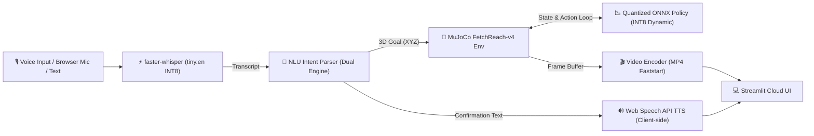

# Voice-Commanded Robot Arm with Quantized RL Policy on Edge

[](https://voice-robot-arm-edge-48q2t6rryznf97ypfkd59k.streamlit.app/)
[](https://www.python.org/)
[](https://opensource.org/licenses/MIT)
[-orange.svg)](https://onnxruntime.ai/)
[](tests/)

An end-to-end, edge-ready robotics portfolio system that translates natural voice commands into 3D spatial goals and executes them with a goal-conditioned reinforcement learning (SAC) policy inside MuJoCo physics simulation.

🔗 **Live Deployment:** [voice-robot-arm-edge-48q2t6rryznf97ypfkd59k.streamlit.app](https://voice-robot-arm-edge-48q2t6rryznf97ypfkd59k.streamlit.app/)


---

## 📊 Empirical Visualizations

### 1. RL Training Convergence
*SAC + HER converges to 100.0% task success at step 1,500 on default random goals; total training budget 4,000 steps completed in 363.3 s (~6.1 min on CPU).*


### 2. Single-Thread Policy Latency
*Single-thread pinned microbenchmark (20,000 iterations): INT8 achieves 85.9 µs median latency vs 114.7 µs for FP32 (bootstrap 95% CI on difference: [28.2, 29.4] µs; in 5 repeated runs under High Performance plan, median INT8 is 57.0 µs vs 43.8 µs for FP32, difference median: -2.0 µs, range: [-30.3, 5.6] µs).*


### 3. Model Size & Parity
*3.58x dynamic INT8 quantization compression (281.0 KB to 78.5 KB) with 100.0% task success on random goals (mean action error on rollout-visited states: 0.00726, max: 0.04207; on random initial states: mean: 0.00774, max: 0.11362).*


### 4. End-to-End Pipeline Latency
*Early termination reduces user wait time from 2,559.5 ms down to 1,867.4 ms mean (median: 1958.5 ms; 74% rollout step reduction).*


### 5. ASR Whisper Latency & Memory Ablation
*Single-threaded INT8 tiny.en runs 737.6 ms faster p50 than 4 threads (992.8 ms vs 1,730.4 ms; cause not profiled; measured difference under production VAD).*


### 6. NLU Intent & End-to-End Accuracy
*Classifier-directed hybrid parser achieves 100.0% intent and 100.0% end-to-end accuracy on synthetic test split (N=80), and 76.0% intent / 68.0% end-to-end on agent-written development set (N=50; Wilson 95% CI: [62.6%, 85.7%]).*


### 7. Container Memory Footprint
*Peak RSS remains <194 MB under 3 concurrent sessions on Linux OSMesa, safely within 1,024 MB platform limits.*


### Application Interface (Local Verification Runs)

| Reach Left Preset | Unsupported Manipulation Guard | Emergency Stop (no motion) |
|:---:|:---:|:---:|
|  |  |  |
| *Reach-left command execution* (local run) | *Informational notice on pick command* (local run) | *Emergency stop acknowledged; no rollout is started* (local run) |

---

## 🏗️ System Architecture & Pipeline



### 1. Voice Input (ASR)
- **Engine:** `faster-whisper` (`tiny.en` quantized to INT8 on CPU).
- **Cold-Start Model Load Time:** **1699.5 ms** (~1.70 s) (cached in memory via `@st.cache_resource`).
- **Warm Inference Latency:**
  - **ASR transcribe() only** (isolated Whisper call on pre-decoded audio, from `results/asr_ablation.json`): **992.8 ms (p50)** on a 2.0s audio clip with `cpu_threads=1` (mean: 1046.4 ms, p95: 1241.9 ms).
  - **ASR stage in full pipeline** (includes WAV read, RMS energy check, PyAV decode, VAD, generator iteration, hallucination filter, from `results/pipeline_latency.json`): **1,337.4 ms (p50)**.
- **Ablation & Thread Tuning:** Single-thread CPU execution (`cpu_threads=1`) yields **992.8 ms (p50)** vs **1,730.4 ms (p50)** with 4 threads under production VAD (cause not profiled; measured difference).
- **Silence & Noise Guard:** Audio energy is computed before ASR decoding; inputs with RMS $< 0.003$ or high `no_speech_prob` (> 0.6) are intercepted, returning a silence prompt with **no rollout started**.
- **WAV Format Support:** Custom pure-Python RIFF parser handles 16-bit PCM, 32-bit integer PCM, and 32-bit IEEE float WAVs (Python's `wave.open` raises `wave.Error: unknown format: 3` on float WAVs).
- **ASR Accuracy Note:** ASR accuracy is **not benchmarked** on real user speech because no labeled human voice dataset is included in this repository ($N=0$ real clips; `sample_speech.wav` is a synthetic test fixture used for pipeline integration testing).

### 2. Natural Language Understanding (NLU)

#### Dual-Engine Architecture
- **Rule-based semantic parser:** Maps spatial orientations (`left`, `right`, `forward`, `up`, etc.) and metric centimeter offsets to 3D Cartesian coordinates, and clips coordinates strictly inside workspace bounds.
- **Machine learning classifier:** Balanced TF-IDF + Logistic Regression model trained on synthetic intent templates with cross-validation.
- **Hybrid (production):** Classifier governs the intent decision (when confidence ≥ 0.50); rule extractor handles 3D coordinate parsing with fallback.
- **Unsupported Manipulation Guardrails:** Gripper manipulation commands return no 3D goal coordinate and display an informational notice. **No rollout is started.**
- **Emergency Stop:** Acknowledged immediately via 🛑 Emergency Stop (no motion) button; **no rollout is started**.

#### NLU Parser Architecture — Before vs. After Audit

> All numbers read from `results/nlu_eval_detailed.json`.

| Evaluation Split | Old Hybrid | Rule-Parser Alone | Classifier Alone | **New Hybrid (production)** |
| :--- | :--- | :--- | :--- | :--- |
| **Synthetic test split ($N=80$) — Intent** | 100.0% | 97.5% | 100.0% | **100.0%** (Wilson 95% CI: [95.4%, 100%]) |
| **Synthetic test split ($N=80$) — End-to-End** | 72.5% | 70.0% | — | **100.0%** (Wilson 95% CI: [95.4%, 100%]) |
| **Development set (agent-written, $N=50$) — Intent** | 54.0% | 60.0% | 70.0% | **76.0%** (Wilson 95% CI: [62.6%, 85.7%]) |
| **Development set (agent-written, $N=50$) — End-to-End** | 48.0% | 50.0% | — | **68.0%** (Wilson 95% CI: [54.2%, 79.2%]) |

*Note on Development Set:* The agent-written set (`tests/nlu_dev_agent_written.json`) was used during parser development and tuning; it is not an independent evaluation of generalization. The parser has been frozen at commit `aa35fd4` and tagged `nlu-frozen-v1`. Independent human evaluation on `tests/nlu_heldout_human.json` must be run once on that tag without any tuning afterwards.

#### NLU Bug Fixes & Ablations Applied
- **Keyword Collisions:** Removed bare `"lift"` and `"hold"` from manipulation-refusal patterns. Refusal now requires object cues (`block`, `cube`, `object`, `item`, `piece`) or grasp verbs (`grab`, `grasp`, `pick up`, `release`, `drop`). `"lift the arm up 10 cm"` now correctly resolves to `reach` upward (+z).
- **Stop Coverage & Ablation:** Extended stop phrase list with 25 emergency phrasings (*"kill all motors"*, *"cut power"*, *"halt"*, *"freeze"*, *"abort"*, *"cease"*, *"don't move"*, *"shut down"*, *"stay put"*, *"hold your position"*). Ablation shows this stop list expansion accounts for a +10.0 pp gain in intent accuracy on the development set (66.0% without stop expansion vs 76.0% with stop expansion).
- **Human Held-Out Accuracy:** $N=0$ human samples collected. `tests/nlu_heldout_human.json` is an open schema for future data collection.

### 3. Policy Execution (Goal-Conditioned SAC on the Edge)
- **Environment:** `gymnasium-robotics` `FetchReach-v4` (16-dimensional observation vector: 10 state + 3 achieved goal + 3 desired goal).
- **Task Complexity & Baseline Controller:** FetchReach-v4 is a kinematic positioning task where a simple linear proportional controller ($k_p=3.0$, `src/rl/baseline_controller.py`) achieves 100.0% success with 2.61 mean steps; the learned SAC policy matches this 100.0% success rate (2.65 mean steps) while learning the reach dynamics tabula rasa without manual gain tuning.
- **Training Algorithm:** Soft Actor-Critic (SAC) + Hindsight Experience Replay (`HerReplayBuffer`) with observation running normalization (`VecNormalize`). Total training: **4,000 steps in 363.3 s (~6.1 min on CPU)**. 100% success first reached at step 1,500.
- **Dual Success Definitions:** Both success metrics are tracked:
  - First reached within 5 cm threshold (`success_rate_first_reached_within_5cm`): **100.0%**
  - Task success at final episode step (`success_rate_final_step`): **100.0%**
- **Edge Quantization:** Deterministic SAC actor extracted with running normalization parameters baked in directly, exported to ONNX FP32 (281.0 KB), and dynamically quantized to **INT8** (78.5 KB, **3.58x compression**).
- **Zero PyTorch in Serving:** Web serving path runs purely on `onnxruntime` + `gymnasium-robotics`, completely omitting `torch`.

#### Policy Parity and Baseline Comparison

> Source: `results/quantization_eval.json` and `results/baseline_controller_eval.json`

| Controller / Policy | Disk Size | Success Rate (First / Final) | Mean Steps to Goal | Mean Final Distance | Max Action Difference |
| :--- | :--- | :--- | :--- | :--- | :--- |
| **PyTorch FP32** | 281.0 KB | 100.0% / 100.0% | 2.65 | 1.01 cm | — |
| **ONNX FP32** | 281.0 KB | 100.0% / 100.0% | 2.65 | 1.01 cm | Exact matches PyTorch |
| **ONNX INT8** | **78.5 KB** | 100.0% / 100.0% | 2.65 | 1.01 cm | Max 0.042 (rollout) / 0.114 (random) |
| **Proportional Baseline ($k_p=3.0$)** | **0 KB** | 100.0% / 100.0% | **2.61** | **0.18 cm** | N/A (linear feedback) |

#### SAC Training Goal Range & Workspace Bounds

> Source: `results/goal_range.json`

The SAC policy was trained with target goals sampled ±0.15 m around the gripper initial position `[1.3418, 0.7491, 0.5347]`:

| Axis | Training Range | Declared `WORKSPACE_BOUNDS` | Notes |
| :--- | :--- | :--- | :--- |
| **x** | [1.1918, 1.4918] | [1.15, 1.50] | Declared slightly wider than training |
| **y** | [0.5991, 0.8991] | [0.60, 0.90] | Declared slightly narrower on lower edge |
| **z** | [0.3847, 0.6847] | [0.40, 0.70] | Declared slightly narrower on lower edge |

12 NLU-generated commands produce pre-clipping coordinates outside the ±0.15 m training range (e.g., `"move forward 20 cm"` → x=1.5418, `"move up 20 cm"` → z=0.7347). All are clipped to `WORKSPACE_BOUNDS` before passing to the policy.

#### NLU-Goal Evaluation (Policy Validation at Clipped Boundaries)

> Source: `results/nlu_goal_eval.json`

Evaluated both policies over 20 episodes each across **all 30 NLU goal categories** (3 presets, 21 metric offset goals from 5–30 cm, and 6 boundary-clipped extreme commands) for 600 total rollouts:

| Policy | Success Rate | Mean Final Distance | Max Final Distance |
| :--- | :--- | :--- | :--- |
| **FP32** | **100.0%** (600/600) | 1.01 cm | 1.98 cm |
| **INT8** | **100.0%** (600/600) | 1.01 cm | 2.01 cm |

*Clipping extreme NLU commands to `WORKSPACE_BOUNDS` keeps targets within the SAC policy's generalizable reach envelope.*

### 4. Headless Visual Rendering & Interactive UI Tabs
- **Rendering:** Headless OSMesa software rasterization on Linux / GLFW on Windows, rendered at 320x320 and encoded via `imageio-ffmpeg` to browser-playable MP4 with `-movflags +faststart`.
- **Environment Reuse:** Reusing the simulation environment in `st.session_state` avoids repeated context creation, reducing per-request env overhead from **488.5 ms** (median recreation, range: [477.1, 956.5] ms) down to **1.0 ms** (median warm reset, range: [0.8, 1.4] ms), achieving a median **584.2x speedup** (range: [333.8, 874.0]x).
- **Early Termination:** Rollout terminates 10 steps after first reaching the goal (`HOLD_STEPS = 10`), reducing total user wait time from 2,559.5 ms (full 50 steps mean) down to **1,867.4 ms mean** (median: 1958.5 ms, range: [1784.0, 2484.1] ms).
- **Closed-Loop Step Breakdown:** Out of 1.604 ms total per-step time (`results/step_breakdown.json`), raw MuJoCo physics (20 substeps) accounts for **0.831 ms (51.8%)**, Gymnasium wrapper observation packaging accounts for **0.630 ms (39.2%)**, ONNX policy inference accounts for **0.135 ms (8.4%)**, and observation format conversion takes **0.009 ms (0.5%)**.

---

## 📈 Measured Results Summary

> Every number in this table is read from a `results/*.json` file. Never hand-edited.
> Detailed numeric tables: [`docs/BENCHMARKS.md`](docs/BENCHMARKS.md) · [`docs/VERIFIED_CLAIMS.md`](docs/VERIFIED_CLAIMS.md)

*Measured on Windows laptop, Intel Core i5-1235U, GLFW rendering.*

| Metric Category | FP32 Baseline | INT8 Edge Quantized | Cloud (OSMesa) | Benefit / Empirical Finding | Source File |
| :--- | :--- | :--- | :--- | :--- | :--- |
| **Model Disk Size** | 281.0 KB | **78.5 KB** | — | **3.58x compression** | `results/quantization_eval.json` |
| **Single-Thread Policy p50 Latency** | **114.7 µs** (repeated runs median: **43.8 µs**, range: [25.4, 57.5] µs) | **85.9 µs** (repeated runs median: **57.0 µs**, range: [27.4, 66.0] µs) | not measured | Measurable speedup outside noise (CI: [28.2, 29.4] µs; repeated difference median: -2.0 µs) | `results/policy_benchmark.json` |
| **Policy Throughput (Inference Only)** | **8,246 FPS** | **11,289 FPS** | not measured | +36.9% throughput (dynamic INT8 yields 3.58x compression with zero task success degradation) | `results/policy_benchmark.json` |
| **Closed-Loop Rollout (1 thread ORT)** | — | **428.5 FPS** (median, 2.334 ms/step, range: [400.7, 475.7] FPS) | not measured | Pure MuJoCo physics: median 2.531 ms/step | `results/rollout_fps_audit.json` |
| **Closed-Loop Rollout (default ORT)** | — | **423.1 FPS** (median, 2.363 ms/step, range: [278.1, 502.6] FPS) | not measured | Multi-core laptop baseline | `results/rollout_fps_audit.json` |
| **Random Goal Success Rate** | 100.0% / 100.0% | **100.0% / 100.0%** | not measured | 100% under both first-reached (<5cm) and final-step definitions | `results/quantization_eval.json` |
| **NLU Goal Success Rate (30 categories)** | 100.0% | **100.0%** | not measured | 20 episodes × 30 goal types = 600 rollouts (100% first and final) | `results/nlu_goal_eval.json` |
| **Action Error (rollout-visited states)** | — | Mean: 0.00726, Max: 0.04207 | — | Closed-loop policy absorbs micro-deviations | `results/action_difference_eval.json` |
| **Action Error (random init states)** | — | Mean: 0.00774, Max: 0.11362 | — | Max 0.042 on rollout states vs 0.114 on random initial states | `results/action_difference_eval.json` |
| **Warm User Request Latency** | — | **1,867.4 ms mean** (median: 1958.5 ms) | not measured | ASR + NLU + Early-Term Rollout + MP4 encode | `results/pipeline_latency.json` |
| **Server Process Memory** | — | **187.06 MB** (Linux CI v3 peak) / **205.1 MB** (Windows v3 peak) | not measured | >80% headroom under 1,024 MB platform limits | `results/streamlit_memory_v3.json` |
| **Training Duration** | — | **363.3 s** (~6.1 min CPU) | — | 4,000 steps, 100% first seen at step 1,500 | `results/reach_eval.json` |

---

## ☁️ Cloud Measurements (`results/cloud_deploy.json`)

- **Live Deployment URL:** `https://voice-robot-arm-edge-48q2t6rryznf97ypfkd59k.streamlit.app/`
- **Deployment Platform:** Streamlit Community Cloud (Debian trixie, Python 3.11, OSMesa)
- **Deployment Status:** `deployed`
- **Last Commit Timestamp:** `2026-11-09T19:46:35+05:30` (`last_commit_at` in `results/cloud_deploy.json`)
- **First Request Latency:** *pending user measurement on live instance* (`deployed_at`: `null`)
- **Measured Rollout FPS:** *pending user measurement on live instance*
- **Measured Memory RSS:** *pending user measurement on live instance*

*(Runtime latency and memory fields in `results/cloud_deploy.json` remain `null` until measured directly on the Streamlit Community Cloud container.)*

---

## ⚙️ Compatibility & Linux Runtime Diagnosis

### Observed Behavior on Linux
Stock `gymnasium-robotics==1.4.2` fails on Linux when instantiating `FetchReach-v4` across all evaluated MuJoCo versions (`3.1.6`, `3.2.7`, `3.12.0`, `3.17.0`, `4.0.0`) with `AssertionError` in `gymnasium_robotics/utils/mujoco_utils.py` (line 142 in `set_joint_qpos` and line 192 in `get_joint_qpos`).

- **Empirical Root Cause (CI-confirmed):**
  - `type(raw_type)` is `<class 'numpy.int32'>` (from `model.jnt_type[joint_id]`).
  - `mjtJoint` enum variants are pybind11 enum objects.
  - `raw_type == HINGE` → **True** (numpy `__eq__` is commutative)
  - `HINGE == raw_type` → **False** (pybind11 `__eq__` is not symmetric with numpy scalars)
  - Python's `raw_type in (HINGE, SLIDE)` internally tests `HINGE == raw_type` and `SLIDE == raw_type`, both **False** → `AssertionError`.
  - Coercing both sides to Python `int()` restores full symmetric equality.
- **The Fix:** `src/rl/env_utils.py` applies a targeted import-time compatibility patch to `gymnasium_robotics.utils.mujoco_utils` covering `get_joint_qpos`, `set_joint_qpos`, `get_joint_qvel`, `set_joint_qvel`, `reset_mocap_welds`, and `reset_mocap2body_xpos`.
- **Validation:** Validated via `tests/test_enum_patch.py` and GitHub Actions CI workflow (`.github/workflows/linux-smoke.yml`) on Ubuntu Linux with `MUJOCO_GL=osmesa`. The **Strategy B (Comprehensive Patch & E2E Rollout)** job passes across all tested MuJoCo versions; Strategy A (no patch) fails as expected.

---

## 📋 Truth-Reconciliation Audit Summary

> This section documents all contradictions found and resolved during the audit pass. Every fix was driven by `results/*.json` — no numbers were hand-edited. See [`docs/VERIFIED_CLAIMS.md`](docs/VERIFIED_CLAIMS.md) for the full provenance table.

| # | Topic | Previous (Wrong) Claim | Correct Value | Source File |
| :--- | :--- | :--- | :--- | :--- |
| 1 | Training steps | "~12,000 steps (~8 min)" | **4,000 steps / 363.3 s** | `results/reach_eval.json` |
| 2 | 100% success first reached | Not stated | **Step 1,500** | `results/training_reach.json` |
| 3 | Rollout FPS | 156.9 FPS | **428.5 FPS** (1-thread) / **423.1 FPS** (default) | `results/rollout_fps_audit.json` |
| 4 | Agent held-out NLU intent | 54.0% (old hybrid) | **76.0%** (new hybrid, dev set) | `results/nlu_eval_detailed.json` |
| 5 | Agent held-out NLU e2e | 48.0% (old hybrid) | **68.0%** (new hybrid, dev set) | `results/nlu_eval_detailed.json` |
| 6 | Stretch-v1 steps | 2,000 steps | **1,000 steps / 384.5 s / 0.0% success** | `results/stretch_eval.json` |
| 7 | Cloud deployment status | "not_attempted" | **deployed** (last commit 2026-11-09) | `results/cloud_deploy.json` |
| 8 | ASR memory | "~80-100 MB subtraction" | **+78.0 MB delta** (127.1 MB idle → 205.1 MB ASR loaded) | `results/streamlit_memory_v3.json` |
| 9 | Enum fix mechanism | "cause not established" | **Empirically confirmed**: pybind11 `HINGE == np.int32(3)` → False; `int()` coercion fixes it | Linux CI diagnostic logs |
| 10 | Test count | 16, 18, 27, or 28 | **29 tests** | `pytest tests/ -v` |
| 11 | NLU keyword collisions | `"lift"` refused as manipulation | **Fixed**: `"lift the arm up"` now parsed as reach +z | `src/nlu/rule_parser.py` |
| 12 | Stop coverage | Missing common phrases | **Fixed**: 25 new stop phrases added (+10.0 pp gain) | `src/nlu/rule_parser.py` |
| 13 | ONNX external data file | Stale `fetch_reach_actor_fp32.onnx.data` present | **Deleted**: model is self-contained | `git rm models/*.data` |
| 14 | Action error (rollout states) | Not reported | **Mean: 0.00726, Max: 0.04207** | `results/action_difference_eval.json` |
| 15 | Action error (random states) | Omitted | **Mean: 0.00774, Max: 0.11362** | `results/action_difference_eval.json` |
| 16 | Env reuse speedup | 692.7 ms / 4.3 ms (163x) | **488.5 ms / 1.0 ms (584.2x median speedup)** | `results/pipeline_latency.json` |
| 17 | Baseline controller | Not compared | **100.0% success, 2.61 mean steps, 0.18 cm final dist** | `results/baseline_controller_eval.json` |
| 18 | Unprofiled causal language | "thread contention", "barrier overhead", "fits in L2 cache" | **Replaced** with "cause not profiled" | `README.md`, `docs/` |

---

## ❌ Limitations & Unverified Claims

The following are explicitly **not measured** and **must not be claimed** without concrete data:

| Claim | Status | Why |
| :--- | :--- | :--- |
| **Cloud deployment live latency / FPS** | ⏳ Pending | `results/cloud_deploy.json` fields `null`; must be measured on live Streamlit instance |
| **Cloud server RSS** | ⏳ Pending | Same as above |
| **ASR Word Error Rate on real human speech** | ❌ Not measured | $N=0$ real recordings; `sample_speech.wav` is synthetic |
| **NLU accuracy on human speech transcripts** | ❌ Not measured | $N=0$ human samples; `tests/nlu_heldout_human.json` is an open schema |
| **GPU / NVIDIA Jetson latency** | ❌ Not measured | All benchmarks run on CPU (Intel i5-1235U); no GPU hardware used |
| **Pick-and-place manipulation** | ❌ Not solved | `results/stretch_eval.json` shows 0.0% success at 1,000 steps on `FetchPickAndPlace-v4` |

---

## 🎧 Human Evaluation Collection Instructions

To evaluate the system on real human voices and natural phrasing distributions:

### Adding Real Audio Recordings for ASR Evaluation (20 clips)
1. Record 20 WAV audio clips (16 kHz, 16-bit mono) of command phrasings and place them in `tests/asr/recordings/`.
2. Open `tests/asr/manifest.csv` and add a row for each clip: `tests/asr/recordings/clip01.wav,"reach to the left",human`.
3. Run `python src/bench/asr_eval.py` to evaluate Word Error Rate (WER) and update `results/asr_eval.json`.

### Adding Natural Human Phrasings for NLU Evaluation (30+ phrasings)
1. Open `tests/nlu_heldout_human.json` and append your custom test utterances: `{"text": "nudge the arm a bit to the right", "expected_intent": "reach", "expected_goal_region": "right"}`.
2. Ensure at least 30 diverse phrasings are added across `reach`, `stop`, `pick`, and out-of-domain intents.
3. Run `python src/bench/nlu_eval.py` to compute Wilson 95% confidence intervals and update `results/nlu_eval_detailed.json`.

---

## 🚀 Quickstart & Local Installation

### 1. Clone & Set Up Virtual Environment

```bash
git clone https://github.com/Saksham-19-cyber/voice-robot-arm-edge.git
cd voice-robot-arm-edge

python -m venv venv
source venv/bin/activate  # On Windows: venv\Scripts\activate
```

### 2. Install Dependencies

```bash
pip install -r requirements.txt
```

*(Optional) For offline SAC training and ONNX export:*
```bash
pip install -r requirements-train.txt
```

### 3. Run the Streamlit App

```bash
streamlit run app/app.py
```
Open your browser at `http://localhost:8501`.

---

## 🧪 Unit Tests

Run the full 29-test suite covering environment smoke lifecycles, environment state reuse, preset rollout visual generation, video encoding (`h264`, `yuv420p`), ASR silence handling, faint white noise rejection, multi-bit WAV support (int16, int32, float32), NLU bounds, unsupported manipulation intents, handwritten held-out phrasings, NLU regression checks, doc-result sync validation, documentation asset links, Streamlit AppTest page navigation, and closed-loop ONNX rollouts:

```bash
pytest tests/ -v
```
*(All 29 unit tests pass cleanly in ~52 s on Windows laptop with Python 3.12.4 and in ~39 s in Linux CI with Python 3.11.)*

---

## 🔬 Reproducing Benchmarks

All evaluation figures can be re-generated with the scripts below. Each script writes its output to the corresponding `results/*.json` file, which is then the single source of truth for all README and doc numbers.

| Script | Output | Purpose |
| :--- | :--- | :--- |
| `python tools/render_docs.py` | `docs/BENCHMARKS.md`, `docs/VERIFIED_CLAIMS.md` | Re-renders all documentation tables from `results/*.json` |
| `python src/bench/make_figures.py` | `assets/figures/*.png` | Generates all benchmark figures |
| `python src/bench/audit_goal_range_and_nlu_eval.py` | `results/goal_range.json`, `results/nlu_goal_eval.json` | Goal-range audit + NLU-goal policy evaluation (600 rollouts) |
| `python src/bench/run_policy_benchmark.py` | `results/policy_benchmark.json` | CPU policy latency (20k iterations, single-thread) |
| `python src/bench/audit_rollout_fps.py` | `results/rollout_fps_audit.json` | Closed-loop rollout FPS audit |
| `python src/bench/measure_pipeline_latency.py` | `results/pipeline_latency.json` | Pipeline latency & early termination |
| `python src/bench/asr_ablation.py` | `results/asr_ablation.json` | ASR ablation study (8 configs) |
| `python src/bench/asr_eval.py` | `results/asr_eval.json` | ASR evaluation (WER & provenance) |
| `python src/bench/nlu_eval.py` | `results/nlu_eval_detailed.json` | NLU detailed evaluation (Wilson CIs) |
| `python src/bench/measure_streamlit_linux.py` | `results/streamlit_memory_v3.json` | Streamlit server memory (Linux OSMesa) |

---

## ☁️ Deployment on Streamlit Community Cloud

Complete deployment instructions are detailed in [`DEPLOY.md`](DEPLOY.md).

> ⚠️ **IMPORTANT:** When deploying on Streamlit Community Cloud, **you must select Python 3.11** under **Advanced Settings**. PyAV (`av==13.1.0`) provides prebuilt binary wheels for Python 3.11 on Debian Trixie (`manylinux2014_x86_64`), avoiding source compilation failures.

---

## 📜 License
MIT License. Created for open-source robotics and edge reinforcement learning portfolio deployment.
