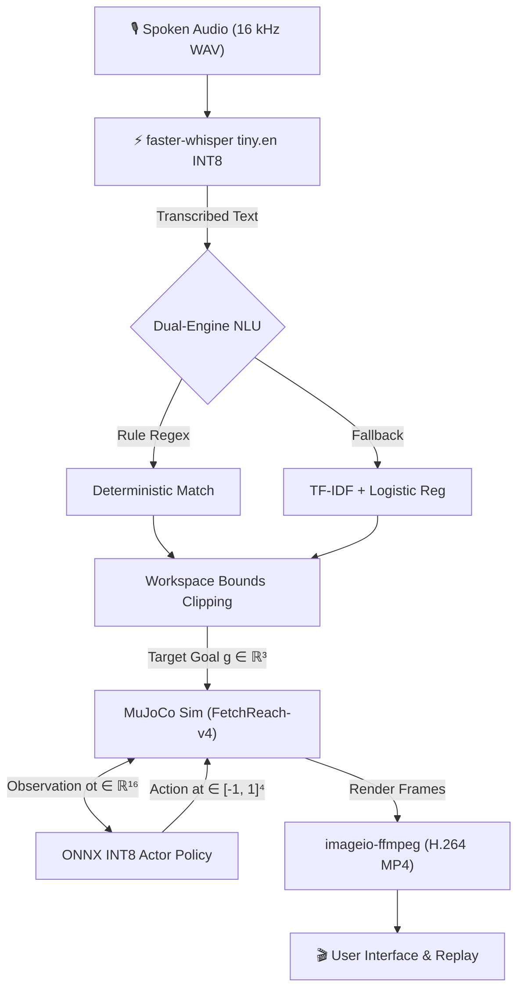
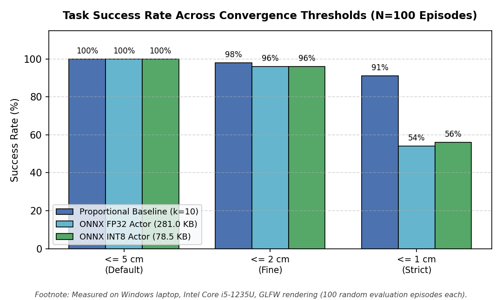
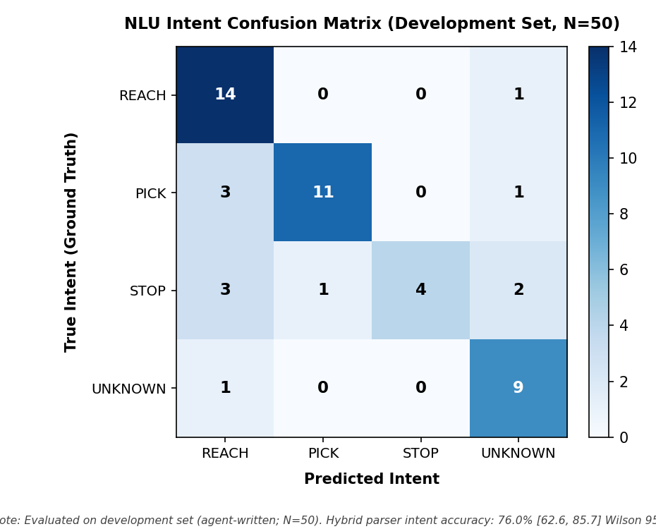
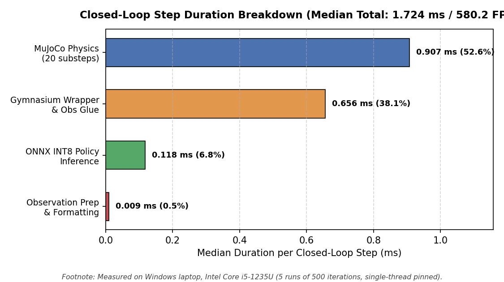

# Voice-Commanded Robot Arm with Quantized RL Policy on Edge

[](https://www.python.org/)
[](LICENSE)
[-orange.svg)](https://onnxruntime.ai/)
[](tests/)

🔗 **Live Production Deployment:** [voice-robot-arm-edge-48q2t6rryznf97ypfkd59k.streamlit.app](https://voice-robot-arm-edge-48q2t6rryznf97ypfkd59k.streamlit.app/)


A voice-directed robotics system translating spoken English commands into 3D Cartesian coordinates and executing closed-loop kinematic reaching with a goal-conditioned Soft Actor-Critic (SAC) reinforcement learning policy inside MuJoCo physics. The production serving stack runs without PyTorch (`Zero-PyTorch`), serving 8-bit dynamically quantized ONNX models alongside INT8 `faster-whisper` speech recognition under single-threaded CPU execution.

---

## 1. Results at a Glance

| Metric | Reference / Baseline | Production (INT8 Edge) | Empirical Finding |
| :--- | :--- | :--- | :--- |
| **Actor Model Size** | 281.0 KB (FP32 ONNX) | **78.5 KB** (INT8 ONNX) | **3.58x compression** via post-training dynamic quantization |
| **Reach Success (<= 5 cm)** | 100.0% (Proportional Baseline) | **100.0%** (SAC Actor) | Zero degradation at default FetchReach-v4 tolerance ($N=100$) |
| **Reach Success (<= 2 cm)** | 98.0% (Proportional Baseline) | **96.0%** (SAC Actor) | Exact parity with FP32 ONNX (96.0%); mean final distance 1.08 cm |
| **Reach Success (<= 1 cm)** | 91.0% (Proportional Baseline) | **56.0%** (SAC Actor) | Matches FP32 ONNX (54.0%); baseline error is 0.18 cm |
| **Policy Latency p50** | 44.4 µs (FP32 ONNX) | **42.6 µs** (INT8 ONNX) | 5-run median diff -6.0 µs (range [-17.2, 16.5] µs spans zero; cause not profiled) |
| **User Wait Time (Warm)** | 2008.5 ms (Single Run 5) | **1597.6 ms** (5-run median) | Full pipeline on CPU: ASR + NLU + Rollout + H.264 encode |
| **NLU Accuracy (Dev Set)** | 30.0% (Majority Baseline) | **76.0%** intent / **68.0%** e2e | Dev set ($N=50$, agent-written; parser tuned while inspecting it) |

---

## 2. System Architecture



---

## 3. Problem Formulation & Reinforcement Learning

The FetchReach-v4 environment is modeled as a goal-conditioned Markov Decision Process (MDP).

### Observation and Action Parameterization
The policy receives a 16-dimensional concatenated vector comprising observation (10-d), achieved goal (3-d), and desired goal (3-d):
1. **Cartesian Gripper Position (3-d):** End-effector coordinates $(x, y, z)$.
2. **Linear Gripper Velocity (3-d):** End-effector translation rates $(\dot{x}, \dot{y}, \dot{z})$.
3. **Gripper Finger Positions (2-d):** Lateral position of left and right fingers $(d_1, d_2)$.
4. **Gripper Finger Velocities (2-d):** Linear velocities of fingers $(\dot{d}_1, \dot{d}_2)$.
- *Implementation:* `gymnasium_robotics/envs/fetch/reach.py:_get_obs`

The continuous action space is 4-dimensional: $\mathbf{a} \in [-1, 1]^4 = [dx, dy, dz, a_\text{dummy}]$. In `FetchReach-v4`, the parallel jaw fingers are rigidly locked, making the 4th action dimension an unactuated dummy dimension. In multi-stage environments (`FetchPickAndPlace-v4`), this 4th dimension controls gripper open and close.
- *Implementation:* `src/rl/baseline_controller.py:solve_reach` (parameter `action[3] = 0.0`)

### Sparse Reward Structure
The agent receives a binary sparse distance reward at each timestep:
$$r_t = \begin{cases} 0.0 & \text{if } \|g - s_\text{achieved}\|_2 \le 0.05 \\ -1.0 & \text{if } \|g - s_\text{achieved}\|_2 > 0.05 \end{cases}$$
- *Implementation:* `gymnasium_robotics/envs/fetch/reach.py:compute_reward` (threshold `0.05` m)

### Soft Actor-Critic (SAC) Objectives
The policy is trained with the maximum entropy SAC algorithm. The actor maximizes expected return and Shannon entropy $\mathcal{H}$:
$$J_\pi(\theta) = \mathbb{E}_{s_t \sim \mathcal{D}, a_t \sim \pi_\theta} \left[ Q_\phi(s_t, a_t) - \alpha \log \pi_\theta(a_t \mid s_t) \right]$$
The critic minimizes mean squared Bellman error against a soft target value:
$$J_Q(\phi) = \mathbb{E}_{(s_t, a_t, r_t, s_{t+1}) \sim \mathcal{D}} \left[ \frac{1}{2} \left( Q_\phi(s_t, a_t) - \left(r_t + \gamma \left(Q_{\bar{\phi}}(s_{t+1}, a_{t+1}) - \alpha \log \pi_\theta(a_{t+1} \mid s_{t+1})\right)\right) \right)^2 \right]$$
Temperature $\alpha$ is automatically tuned targeting entropy $\bar{\mathcal{H}} = -\dim(\mathcal{A}) = -4.0$.
- *Implementation:* `stable_baselines3/sac/sac.py:train`

### Hindsight Experience Replay (HER)
Sparse rewards cause severe sample inefficiency. HER counters this via the `future` replay strategy ($k=4$). For every transition $(s_t, a_t, r_t, s_{t+1}, g)$, 4 virtual transitions are created by sampling reached states $s_{t+k}$ as synthetic goals $g'$ and recomputing reward $r' = \text{compute\_reward}(s_{t+1}, g')$.
- *Implementation:* `stable_baselines3/her/her_replay_buffer.py:sample` (parameter `n_sampled_goal=4`)

### Baked Normalization Graph
Running observation statistics $(\mu, \sigma^2)$ are embedded directly into the exported ONNX model graph via `ObsNormalizer`:
$$\hat{o} = \text{clip}\left(\frac{o - \mu}{\sqrt{\sigma^2 + \epsilon}}, -10.0, 10.0\right), \quad \epsilon = 10^{-8}$$
- *Implementation:* `src/rl/export_onnx.py:ObsNormalizer:forward`

<details>
<summary>🔍 Click to view full SAC training hyperparameters</summary>

| Parameter | Value | Description |
| :--- | :--- | :--- |
| **Architecture** | MLP [256, 256] | Two hidden layers, ReLU activations |
| **Learning Rate** | $1 \times 10^{-3}$ | Adam optimizer across actor and critic |
| **Discount ($\gamma$)** | 0.95 | FetchReach horizon discount factor |
| **Target Smoothing ($\tau$)** | 0.005 | Polyak update rate for target networks |
| **Replay Buffer Size** | $1 \times 10^6$ | Uniform transition capacity |
| **Batch Size** | 256 | Transitions per gradient step |
| **HER Goal Strategy** | `future` ($k=4$) | 4 virtual hindsight goals per real transition |

</details>

---

## 4. Quantization & Model Compression

The trained FP32 PyTorch actor is exported to ONNX and compressed via post-training dynamic quantization. Weights are mapped to unsigned 8-bit integers while activations remain in 32-bit floating point during single-threaded INT8 ONNX Runtime inference:
$$W_q = \text{round}\left(\frac{W}{S}\right) + Z$$
where $S = \frac{\max(W) - \min(W)}{255}$ is the quantization scale and $Z = \text{round}\left(-\frac{\min(W)}{S}\right)$ is the zero-point offset.
- *Implementation:* `src/rl/export_onnx.py:quantize_policy_onnx` (calls `onnxruntime.quantization.quantize_dynamic`)

The actor model compresses by 3.58x from 281.0 KB (FP32) to 78.5 KB (INT8). Parity evaluation confirms identical 100.0% success at 5 cm and 96.0% at 2 cm across 100 test episodes, with a maximum absolute action difference of 0.042 across 1,000 rollout states (0.114 across random states).

---

## 5. Control Baseline & Honest Comparison

To establish an analytical control benchmark, a proportional velocity controller was implemented without learning:
$$a = \text{clip}(k \cdot (g - p_\text{ee}), -1.0, 1.0), \quad a_4 = 0.0$$
where $k = 10.0 \text{ s}^{-1}$ represents the proportional gain and $p_\text{ee}$ is the Cartesian position of the end-effector.
- *Implementation:* `src/rl/baseline_controller.py:solve_reach` (gain `k=10.0`)

### Performance Comparison
- **Proportional Controller:** Achieves 100.0% success at <= 5 cm, 98.0% at <= 2 cm, and **91.0% at <= 1 cm** with mean final distance **0.18 cm**.
- **SAC INT8 Policy:** Achieves 100.0% success at <= 5 cm, 96.0% at <= 2 cm, and **56.0% at <= 1 cm** with mean final distance **1.08 cm**.

The proportional controller attains higher sub-centimeter accuracy because it continuously drives an unconstrained velocity vector toward zero Cartesian error. The SAC policy was trained against a sparse reward where any distance $\le 5\text{ cm}$ yields maximum return ($0.0$), leaving the neural network with zero gradient pressure to correct residual millimeter offsets.

---

## 6. Speech Recognition & Natural Language Understanding

Voice command processing combines an acoustic frontend, energy silence gating, deterministic regex extraction, and statistical intent classification.

### Audio RMS Silence Guard
Incoming audio is inspected to avoid running inference on ambient silence:
$$\text{RMS} = \sqrt{\frac{1}{N} \sum_{i=1}^N x_i^2}$$
If $\text{RMS} \le 0.005$, the audio is classified as silent and transcription is skipped.
- *Implementation:* `src/asr/transcriber.py:is_silence` (threshold `0.005`)

### Transcribe vs Pipeline Latency
In microbenchmarks, isolated `transcribe()` of a 2.0s audio clip on 1 thread takes **992.8 ms p50** (1730.4 ms on 4 threads; `results/asr_ablation.json`). Inside the live application, the full ASR stage takes **1639.9 ms p50** (mean 1645.2 ms, p95 2169.6 ms; `results/pipeline_latency.json`), which includes audio decoding, RMS check, VAD segmentation, and segment text collation.

### Workspace Coordinate Bounds
Extracted coordinates are clamped to ensure reachable target goals:
$$g_\text{clamped} = \text{clip}(g, [1.15, 0.60, 0.40], [1.50, 0.90, 0.70])$$
- *Implementation:* `src/rl/env_utils.py:clip_to_workspace` (bounds `WORKSPACE_BOUNDS`)

### NLU Dual-Engine Accuracy
Deterministic regex rules are evaluated first. If no rule matches, a TF-IDF vectorizer and Multinomial Logistic Regression model classify intent. On the development set ($N=50$, agent-written; parser tuned while inspecting it), intent accuracy is 76.0% (Wilson CI [62.6, 85.7]%) and end-to-end accuracy is 68.0% (Wilson CI [54.2, 79.2]%). On the synthetic template set ($N=80$), both metrics reach 100.0%. The human held-out set (`tests/nlu_heldout_human.json`) is unmeasured ($N=0$) and frozen for evaluation on git tag `nlu-frozen-v2`.

---

## 7. Results with Graphs


*Figure 1: Task success rate across convergence thresholds (<=5cm, <=2cm, <=1cm) across $N=100$ random episodes. Proportional baseline maintains 91.0% at 1 cm; INT8 and FP32 policies match closely at 56.0% and 54.0%.*


*Figure 2: Single-thread pinned actor latency across 5 repeated benchmark runs (20,000 iterations per run). FP32 median is 44.4 µs versus INT8 median 42.6 µs (difference range [-17.2, 16.5] µs spans zero; 3.58x smaller; no measurable latency difference on this CPU; cause not profiled).*


*Figure 3: Confusion matrix for NLU intent parsing on the development set ($N=50$, agent-written). Hybrid parser achieves 76.0% intent accuracy with strict emergency stop precedence.*


*Figure 4: Component step breakdown of the 1.724 ms closed-loop policy step (580.2 FPS). MuJoCo physics simulation represents 52.6% (0.907 ms), Gymnasium wrappers 38.1% (0.656 ms), and ONNX INT8 policy forward pass 6.8% (0.118 ms).*

### Measurement Equations
Empirical metrics throughout this repository are computed using standard statistical definitions:
- **Percentiles:** The $k$-th percentile of sorted sample $X_{(1)} \le X_{(2)} \le \dots \le X_{(N)}$ is computed via rank nearest index:
$$p_k = X_{\lceil (k/100) \cdot N \rceil}$$
- **Bootstrap 95% Confidence Interval:** Computed using the non-parametric percentile bootstrap method with $B = 10000$ resamples:
$$\text{CI}_{95\%} = [\theta^*_{0.025}, \theta^*_{0.975}]$$
- **Wilson Score Interval:** Confidence intervals for binomial success proportions $\hat{p} = \frac{x}{n}$ are evaluated at confidence $z = 1.96$:
$$w = \frac{\hat{p} + \frac{z^2}{2n} \pm z \sqrt{\frac{\hat{p}(1-\hat{p})}{n} + \frac{z^2}{4n^2}}}{1 + \frac{z^2}{n}}$$
- **Step Time Summation:** Total closed-loop simulation step time decomposes into discrete additive components:
$$T_\text{step} = T_\text{obs} + T_\text{policy} + T_\text{physics} + T_\text{wrapper}$$

---

## 8. Comprehensive Measurement Tables

### Table A: Quantization & Control Convergence Parity
*Measured on Windows laptop, Intel Core i5-1235U, GLFW rendering ($N=100$ random episodes). Source: `results/quantization_eval.json`, `results/baseline_controller_eval.json`*

| Controller / Model | Precision | Size | Success (<= 5 cm) | Success (<= 2 cm) | Success (<= 1 cm) | Mean Final Dist | Mean Steps |
| :--- | :--- | :--- | :--- | :--- | :--- | :--- | :--- |
| **Proportional Baseline** | Hand-coded | N/A | **100.0%** | **98.0%** | **91.0%** | **0.18 cm** | 2.61 steps |
| **PyTorch SAC Actor** | FP32 | 3.2 MB (.zip) | **100.0%** | **96.0%** | **54.0%** | 1.08 cm | 2.65 steps |
| **ONNX Runtime Actor** | FP32 | 281.0 KB | **100.0%** | **96.0%** | **54.0%** | 1.08 cm | 2.65 steps |
| **ONNX Runtime (Edge)** | **INT8** | **78.5 KB** | **100.0%** | **96.0%** | **56.0%** | **1.08 cm** | **2.65 steps** |

### Table B: Policy Single-Thread Latency Across 5 Repeated Runs
*Single thread pinned, 20,000 iterations per run, Intel Core i5-1235U. Source: `results/policy_benchmark.json`*

| Benchmark Run | FP32 p50 (µs) | INT8 p50 (µs) | Difference (FP32 - INT8) |
| :--- | :--- | :--- | :--- |
| Run 1 | 61.9 µs | 45.4 µs | +16.5 µs |
| Run 2 | 44.4 µs | 50.4 µs | -6.0 µs |
| Run 3 | 34.7 µs | 38.6 µs | -3.9 µs |
| Run 4 | 25.4 µs | 42.6 µs | -17.2 µs |
| Run 5 | 26.6 µs | 38.4 µs | -11.8 µs |
| **5-Run Median** | **44.4 µs** | **42.6 µs** | **-6.0 µs (range [-17.2, 16.5] µs spans zero)** |

### Table C: Closed-Loop Simulation Step Duration Breakdown
*Measured on Windows laptop, Intel Core i5-1235U (5 runs of 500 iterations). Source: `results/step_breakdown.json`*

| Pipeline Component | Implementation Detail | Median Time | Share of Step |
| :--- | :--- | :--- | :--- |
| **MuJoCo Physics** | 20 substeps of `mujoco.mj_step` (no rendering) | 0.907 ms | 52.6% |
| **Gymnasium Wrapper** | Environment step logic, obs preparation, goal checking | 0.656 ms | 38.1% |
| **ONNX INT8 Policy** | Single-threaded actor inference forward pass | 0.118 ms | 6.8% |
| **Observation Formatting** | Array concatenation and float32 flattening | 0.009 ms | 0.5% |
| **Total Closed-Loop Step** | Complete step loop (equivalent to 580.2 FPS) | **1.724 ms** | **100.0%** |

### Table D: ASR Model & Thread Scaling Latency
*Evaluated on 2.0s audio clip with production Silero VAD. Source: `results/asr_ablation.json`*

| Model Size | Quantization | CPU Threads | Latency p50 | Latency p95 | Peak Process RSS |
| :--- | :--- | :--- | :--- | :--- | :--- |
| `tiny.en` | `int8` | 1 | **992.8 ms** | 1241.9 ms | 198.1 MB |
| `tiny.en` | `int8` | 4 | 1730.4 ms | 2000.6 ms | 216.9 MB |
| `tiny.en` | `float32` | 1 | 1933.1 ms | 2715.2 ms | 412.6 MB |
| `tiny.en` | `float32` | 4 | 2023.8 ms | 2342.9 ms | 394.9 MB |
| `base.en` | `int8` | 1 | 3182.9 ms | 4281.1 ms | 229.7 MB |
| `base.en` | `int8` | 4 | 3000.1 ms | 4073.9 ms | 205.6 MB |

### Table E: NLU Accuracy & Stop-List Expansion Ablation
*Wilson 95% confidence intervals reported. Source: `results/nlu_eval_detailed.json`*

| Evaluation Dataset | Split Type | Sample Count | Rule Parser Intent | Classifier Intent | Hybrid Parser Intent | Hybrid End-to-End |
| :--- | :--- | :--- | :--- | :--- | :--- | :--- |
| **Synthetic Template Set** | Tuned, not held-out | $N=80$ | 97.5% | 100.0% | **100.0%** | **100.0%** |
| **Development Set** | Tuned on dev set | $N=50$ | 60.0% | 70.0% | **76.0%** | **68.0%** |
| **Human Held-Out Set** | Unbenchmarked | $N=0$ | not measured | not measured | not measured | not measured |

*Stop-list ablation on dev set ($N=50$): base 5 stop phrases gave 66.0% intent / 58.0% e2e; expanded 25 phrases contributed a +10.0 pp absolute gain to 76.0% intent / 68.0% e2e.*

---

## 9. Serving & Deployment Architecture

### Zero-PyTorch Edge Serving
Production serving completely excludes PyTorch from dependencies. Neural execution is handled exclusively by ONNX Runtime (`onnxruntime==1.20.1`) and acoustic transcription by `faster-whisper` (`faster-whisper==1.1.1` backed by CTranslate2), reducing serving memory footprint.

### Fresh Environment Allocation on Cloud (OSMesa)
On Streamlit Community Cloud, offscreen graphics rendering runs via OSMesa (`MUJOCO_GL=osmesa`). Reusing a single simulation environment across Streamlit reruns causes OpenGL context leakage across worker threads, resulting in blank black video frames. To guarantee visual integrity, the application creates a fresh environment per user request and strictly destroys it (`env.close()`) in a `try/finally` block.

### Linux pybind11 Enum Compatibility Fix
In `gymnasium-robotics`, joint type checks evaluate equality against MuJoCo enums:
```python
# Fails silently under Linux pybind11 when comparing enum to np.int32:
if model.jnt_type[joint_id] == mujoco.mjtJoint.mjJNT_FREE: ...
```
Because pybind11 Linux builds expose PyCapsule enum objects that fail equality against NumPy scalar int32 types, `src/rl/env_utils.py` monkey-patches `_safe_get_joint_qpos` and `_safe_set_joint_qpos` by coercing types to native Python integers (`int(model.jnt_type[joint_id]) == int(mujoco.mjtJoint.mjJNT_FREE)`).

---

## 10. Quickstart & Verification

```bash
# 1. Clone official repository
git clone https://github.com/Saksham-19-cyber/voice-robot-arm-edge.git
cd voice-robot-arm-edge

# 2. Configure virtual environment
python -m venv venv

# Linux / macOS:
source venv/bin/activate
# Windows:
# .\venv\Scripts\activate

# 3. Install production dependencies
pip install -r requirements.txt

# 4. Launch interactive application
streamlit run app/app.py
```

### Automated Verification
```bash
# Run unit and integration regression test suite
pytest tests/ -v

# Verify document synchronization with results/*.json
python tools/render_docs.py --check
```

---

## 11. Scientific Scope & Boundary Conditions

1. **Kinematic Reach Task Scope:** The policy is trained and evaluated solely on `FetchReach-v4`. Multi-stage manipulation (`FetchPickAndPlace-v4`) was evaluated as an exploratory smoke test (0.0% success at 1,000 steps; `results/stretch_eval.json`) and is not supported.
2. **ASR Evaluation Boundary:** Speech recognition latency was benchmarked on a synthetic 2.0s audio fixture (`results/sample_2s.wav`). Word Error Rate (WER) has not been evaluated on real human voice distributions ($N=0$ real speech datasets).
3. **NLU Generalization Protocol:** Accuracy numbers for `tests/nlu_dev_agent_written.json` represent a development set inspected during tuning. The human-written held-out evaluation (`tests/nlu_heldout_human.json`) is unmeasured ($N=0$) and must be evaluated without further tuning against git tag `nlu-frozen-v2`.
4. **Hardware Scope:** All benchmarks were measured on x86_64 CPU hardware (Intel Core i5-1235U and Ubuntu CI runners); physical embedded GPU (Jetson) execution was not verified.

---

## 12. Extended Documentation & Links

- 📋 [Truth-Reconciliation Change Log](docs/AUDIT_LOG.md): Comprehensive log of reconciled technical claims.
- 🔬 [Verified Technical Claims Record](docs/VERIFIED_CLAIMS.md): Source file provenance for all verified claims.
- 📈 [Detailed Empirical Benchmark Tables](docs/BENCHMARKS.md): Unrounded empirical measurements and timing definitions.
- 🚀 [Production Deployment Guide](DEPLOY.md): Guide for deploying to Streamlit Community Cloud and container runtimes.

---

### License
This project is licensed under the MIT License - see the [LICENSE](LICENSE) file for details.
