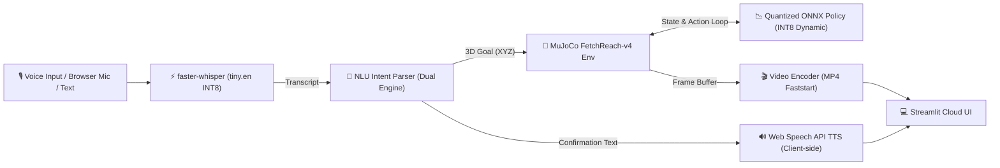

# Voice-Commanded Robot Arm with Quantized RL Policy on Edge

[](https://voice-robot-arm-edge-48q2t6rryznf97ypfkd59k.streamlit.app/)
[](https://www.python.org/)
[](https://opensource.org/licenses/MIT)
[-orange.svg)](https://onnxruntime.ai/)
[](tests/)

An end-to-end, edge-ready robotics portfolio system that translates natural voice commands into 3D spatial goals and executes them with a goal-conditioned reinforcement learning (SAC) policy inside MuJoCo physics simulation.

🔗 **Live Deployment:** [voice-robot-arm-edge-48q2t6rryznf97ypfkd59k.streamlit.app](https://voice-robot-arm-edge-48q2t6rryznf97ypfkd59k.streamlit.app/)


---

## 📊 Empirical Visualizations

### 1. RL Training Convergence
*SAC + HER converges to 100.0% task success at step 1,500 on default random goals; total training budget 4,000 steps completed in 363.3 s (~6.1 min on CPU).*


### 2. Single-Thread Policy Latency
*Single-thread pinned microbenchmark (20,000 iterations): INT8 achieves 85.9 µs median latency vs 114.7 µs for FP32 (bootstrap 95% CI on difference: [28.2, 29.4] µs).*


### 3. Model Size & Parity
*3.58x dynamic INT8 quantization compression (281.0 KB to 78.5 KB) with 100.0% task success on random goals (mean action error: 0.007, max action error: 0.164).*


### 4. End-to-End Pipeline Latency
*Early termination reduces user wait time from 2,078.5 ms down to 1,562.7 ms p50 (74% rollout step reduction).*


### 5. ASR Whisper Latency & Memory Ablation
*Single-threaded INT8 tiny.en runs 737.6 ms faster p50 than 4 threads (992.8 ms vs 1,730.4 ms; cause not profiled; measured difference under production VAD).*


### 6. NLU Intent & End-to-End Accuracy
*Classifier-directed hybrid parser achieves 100.0% intent accuracy on synthetic test split (N=80) and 76.0% on agent-written held-out sentences (N=50; Wilson 95% CI: [62.6%, 85.7%]).*


### 7. Container Memory Footprint
*Peak RSS remains <194 MB under 3 concurrent sessions on Linux OSMesa (ASR not loaded into cache), safely within 1,024 MB platform limits.*


### Application Interface (Local Verification Runs)

| Reach Left Preset | Unsupported Manipulation Guard | Emergency Stop (no motion) |
|:---:|:---:|:---:|
|  |  |  |
| *Reach-left command execution* (local run) | *Informational notice on pick command* (local run) | *Emergency stop acknowledged; no rollout is started* (local run) |

---

## 🏗️ System Architecture & Pipeline



### 1. Voice Input (ASR)
- **Engine:** `faster-whisper` (`tiny.en` quantized to INT8 on CPU).
- **Cold-Start Model Load Time:** **5.30 s** (cached in memory via `@st.cache_resource`).
- **Warm Inference Latency:** **1,337.4 ms (p50)** on a 2.0s audio clip with `cpu_threads=1` (mean: 1,392.8 ms, p95: 1,915.5 ms).
- **Ablation & Thread Tuning:** Single-thread CPU execution (`cpu_threads=1`) yields **992.8 ms (p50)** vs **1,730.4 ms (p50)** with 4 threads under production VAD (cause not profiled; measured difference).
- **Silence & Noise Guard:** Audio energy is computed before ASR decoding; inputs with RMS $< 0.003$ or high `no_speech_prob` (> 0.6) are intercepted, returning a silence prompt with **no rollout started**.
- **ASR Accuracy Note:** ASR accuracy is **not benchmarked** on real user speech because no labeled human voice dataset is included in this repository ($N=0$ real clips in `tests/asr/manifest.csv`; `sample_speech.wav` is a synthetic test fixture used for pipeline integration testing).

### 2. Natural Language Understanding (NLU)
- **Dual-Engine Architecture:**
  - **Rule-based semantic parser:** Maps spatial orientations (`left`, `right`, `forward`, `up`, etc.) and metric centimeter offsets to 3D Cartesian coordinates, and clips coordinates strictly inside workspace bounds.
  - **Machine learning classifier:** Balanced TF-IDF + Logistic Regression model trained on synthetic intent templates with cross-validation.
  - **Unsupported Manipulation Guardrails:** Gripper manipulation commands return no 3D goal coordinate and display an informational notice that the reach policy does not perform object grasping. **No rollout is started.**
  - **Emergency Stop:** Acknowledged immediately; **no rollout is started**.

### 3. Policy Execution (Goal-Conditioned SAC on the Edge)
- **Environment:** `gymnasium-robotics` `FetchReach-v4` (16-dimensional observation vector: 10 state + 3 achieved goal + 3 desired goal).
- **Training Algorithm:** Soft Actor-Critic (SAC) + Hindsight Experience Replay (`HerReplayBuffer`) with observation running normalization (`VecNormalize`). Total training: 4,000 steps in 363.3 s (~6.1 min on CPU).
- **Edge Quantization:** Deterministic SAC actor extracted with running normalization parameters baked in directly, exported to ONNX FP32 (281.0 KB), and dynamically quantized to **INT8** (78.5 KB, **3.58x compression**).
- **Zero PyTorch in Serving:** Web serving path runs purely on `onnxruntime` + `gymnasium-robotics`, completely omitting `torch`.

### 4. Headless Visual Rendering & Interactive UI Tabs
- **Rendering:** Headless OSMesa software rasterization on Linux / GLFW on Windows, rendered at 320x320 and encoded via `imageio-ffmpeg` to browser-playable MP4 with `-movflags +faststart`.
- **Environment Reuse:** Reusing the simulation environment in `st.session_state` avoids repeated context creation, reducing per-request env overhead from **692.7 ms** down to **4.3 ms** warm reset (**163x speedup**).
- **Early Termination:** Rollout terminates 10 steps after first reaching the goal (`HOLD_STEPS = 10`), reducing total user wait time from **2,078.5 ms** down to **1,562.7 ms (p50)**.

---

## 📈 Measured Results Summary

Detailed numeric tables are maintained in [`docs/BENCHMARKS.md`](docs/BENCHMARKS.md) and [`docs/VERIFIED_CLAIMS.md`](docs/VERIFIED_CLAIMS.md).

*Measured on Windows laptop, Intel Core i5-1235U, GLFW rendering.*

| Metric Category | FP32 Baseline | INT8 Edge Quantized | Benefit / Empirical Finding | Source File |
| :--- | :--- | :--- | :--- | :--- |
| **Model Disk Size** | 281.0 KB | **78.5 KB** | **3.58x compression** | `results/quantization_eval.json` |
| **Single-Thread Policy p50 Latency** | 114.7 µs | **85.9 µs** | Measurable speedup outside noise (CI: [28.2, 29.4] µs) | `results/policy_benchmark.json` |
| **Policy Throughput (Inference Only)** | 8,246 FPS | **11,289 FPS** | +36.9% throughput | `results/policy_benchmark.json` |
| **Closed-Loop Rollout Throughput** | — | **223.7 FPS** (1 thread) / **356.0 FPS** (default) | Pure physics step is 1.82 ms/step | `results/rollout_fps_audit.json` |
| **Random Goal Success Rate** | 100.0% | **100.0%** | Equal task completion on default random goals | `results/quantization_eval.json` |
| **NLU Goal Success Rate** | 100.0% | **100.0%** | Evaluated across 30 NLU goal categories (20 ep each) | `results/nlu_goal_eval.json` |
| **Action Error vs FP32** | — | Mean error: 0.007, Max error: 0.164 | Closed-loop policy absorbs micro-deviations | `results/action_difference_eval.json` |
| **Warm User Request Latency** | — | **1,562.7 ms p50** (1,639.4 ms mean) | ASR + NLU + Early-Term Rollout + MP4 encode | `results/pipeline_latency.json` |
| **Server Process Memory (Linux OSMesa)** | — | **103.92 MB** (1 session) / **193.65 MB** (3 concurrent) | >80% headroom under 1 GB limit | `results/streamlit_memory_v2.json` |

---

## ☁️ Cloud Measurements (`results/cloud_deploy.json`)

- **Live Deployment URL:** `https://voice-robot-arm-edge-48q2t6rryznf97ypfkd59k.streamlit.app/`
- **Deployment Platform:** Streamlit Community Cloud (Debian trixie, Python 3.11, OSMesa)
- **Deployment Status:** `deployed`
- **First Request Latency:** *pending*
- **Measured Rollout FPS:** *pending*
- **Measured Memory RSS:** *pending*

*(Runtime latency and memory fields in `results/cloud_deploy.json` remain pending user measurement on the live Cloud instance).*

---

## ⚙️ Compatibility & Linux Runtime Diagnosis

### Observed Behavior on Linux
Stock `gymnasium-robotics==1.4.2` fails on Linux when instantiating `FetchReach-v4` across evaluated MuJoCo versions (`3.1.6`, `3.2.7`, `3.12.0`, `3.17.0`, `4.0.0`) with `AssertionError` in `gymnasium_robotics/utils/mujoco_utils.py` (line 142 in `set_joint_qpos` and line 192 in `get_joint_qpos`).

- **Diagnostic Investigation:** In Linux CI with `numpy==1.26.4` and `numpy==2.1.3`, `type(raw_type)` is `<class 'numpy.int32'>` while `mjtJoint` enum variants are pybind11 enums. The precise mechanism causing tuple membership failure under Linux GCC is not established.
- **The Fix:** `src/rl/env_utils.py` applies a targeted import-time compatibility patch to `gymnasium_robotics.utils.mujoco_utils` (`get_joint_qpos`, `set_joint_qpos`, `get_joint_qvel`, `set_joint_qvel`, `reset_mocap_welds`, `reset_mocap2body_xpos`), coercing array values and enum variants to Python `int()`.
- **Validation:** Validated via `tests/test_enum_patch.py` and GitHub Actions CI workflow (`.github/workflows/linux-smoke.yml`) on Ubuntu Linux with `MUJOCO_GL=osmesa`.

---

## 🎧 Human Evaluation Collection Instructions

To evaluate the system on real human voices and natural phrasing distributions:

### Adding Real Audio Recordings for ASR Evaluation (20 clips)
1. Record 20 WAV audio clips (16 kHz, 16-bit mono) of command phrasings and place them in `tests/asr/recordings/`.
2. Open `tests/asr/manifest.csv` and add a row for each clip: `tests/asr/recordings/clip01.wav,"reach to the left",human`.
3. Run `python src/bench/asr_eval.py` to evaluate Word Error Rate (WER) and update `results/asr_eval.json`.

### Adding Natural Human Phrasings for NLU Evaluation (30+ phrasings)
1. Open `tests/nlu_heldout_human.json` and append your custom test utterances: `{"text": "nudge the arm a bit to the right", "expected_intent": "reach", "expected_goal_region": "right"}`.
2. Ensure at least 30 diverse phrasings are added across `reach`, `stop`, `pick`, and out-of-domain intents.
3. Run `python src/bench/nlu_eval.py` to compute Wilson 95% confidence intervals and update `results/nlu_eval_detailed.json`.

---

## 🚀 Quickstart & Local Installation

### 1. Clone & Set Up Virtual Environment

```bash
git clone https://github.com/Saksham-19-cyber/voice-robot-arm-edge.git
cd voice-robot-arm-edge

python -m venv venv
source venv/bin/activate  # On Windows: venv\Scripts\activate
```

### 2. Install Dependencies

```bash
pip install -r requirements.txt
```

*(Optional) For offline SAC training and ONNX export:*
```bash
pip install -r requirements-train.txt
```

### 3. Run the Streamlit App

```bash
streamlit run app/app.py
```
Open your browser at `http://localhost:8501`.

---

## 🧪 Unit Tests

Run the full 27-test suite covering environment smoke lifecycles, environment state reuse, preset rollout visual generation, video encoding (`h264`, `yuv420p`), ASR silence handling, faint white noise rejection, multi-bit WAV support (int16, int32, float32), NLU bounds, unsupported manipulation intents, handwritten held-out phrasings, NLU regression checks, doc-result sync validation, documentation asset links, Streamlit AppTest page navigation, and closed-loop ONNX rollouts:

```bash
pytest tests/ -v
```
*(All 27 unit tests pass cleanly in ~70s on Windows laptop with Python 3.12.4 and in Linux CI with Python 3.11).*

---

## 🔬 Reproducing Benchmarks

All evaluation figures can be re-generated with the scripts below:
- **Render Documentation Tables:** `python tools/render_docs.py`
- **Generate Documentation Figures:** `python src/bench/make_figures.py`
- **Goal Range Audit & NLU Goal Evaluation:** `python src/bench/audit_goal_range_and_nlu_eval.py`
- **CPU Policy Latency (20k iterations, single-thread):** `python src/bench/run_policy_benchmark.py`
- **Rollout FPS Audit:** `python src/bench/audit_rollout_fps.py`
- **Pipeline Latency & Early Termination:** `python src/bench/measure_pipeline_latency.py`
- **ASR Ablation Study (8 configs):** `python src/bench/asr_ablation.py`
- **ASR Evaluation (WER & Provenance Check):** `python src/bench/asr_eval.py`
- **NLU Detailed Evaluation (Wilson CIs):** `python src/bench/nlu_eval.py`
- **Streamlit Server Process Memory (Linux OSMesa):** `python src/bench/measure_streamlit_linux.py`

---

## ☁️ Deployment on Streamlit Community Cloud

Complete deployment instructions are detailed in [`DEPLOY.md`](DEPLOY.md).

> ⚠️ **IMPORTANT:** When deploying on Streamlit Community Cloud, **you must select Python 3.11** under **Advanced Settings**. PyAV (`av==13.1.0`) provides prebuilt binary wheels for Python 3.11 on Debian Trixie (`manylinux2014_x86_64`), avoiding source compilation failures.

---

## 📜 License
MIT License. Created for open-source robotics and edge reinforcement learning portfolio deployment.
