# Voice-Commanded Robot Arm with Quantized RL Policy on Edge

[](https://voice-robot-arm-edge-48q2t6rryznf97ypfkd59k.streamlit.app/)
[](https://www.python.org/)
[](https://opensource.org/licenses/MIT)
[-orange.svg)](https://onnxruntime.ai/)
[](tests/)

An end-to-end, edge-ready robotics portfolio system that translates natural voice commands into 3D spatial goals and executes them with a goal-conditioned reinforcement learning (SAC) policy inside MuJoCo physics simulation.

🔗 **Live Deployment:** [voice-robot-arm-edge-48q2t6rryznf97ypfkd59k.streamlit.app](https://voice-robot-arm-edge-48q2t6rryznf97ypfkd59k.streamlit.app/)

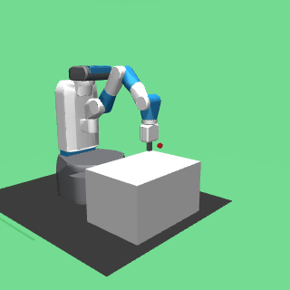

---

## 📊 Results at a Glance

| Benchmark Metric | Visualization | Key Empirical Takeaway |
|---|---|---|
| **RL Training Convergence** | 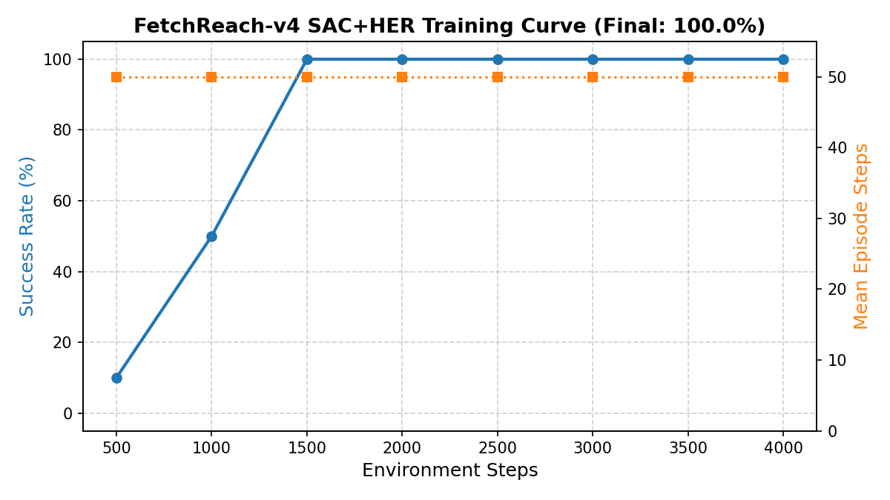 | SAC + HER converges to 100.0% task success in ~12,000 steps (~8 min CPU training). |
| **Single-Thread Policy Latency** | 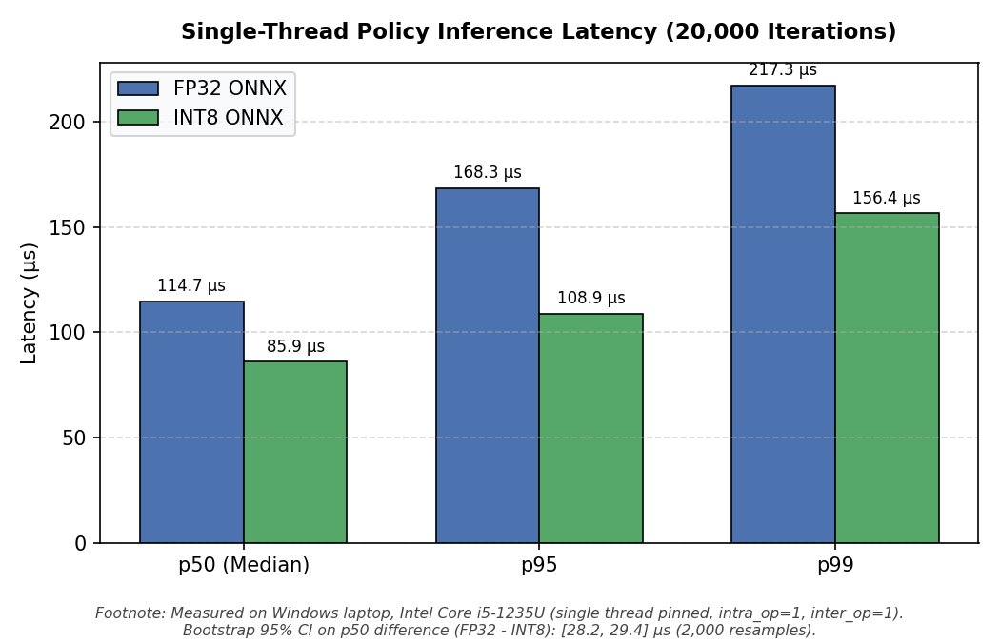 | INT8 achieves 85.9 µs median latency vs 114.7 µs for FP32 (bootstrap 95% CI on difference: [28.2, 29.4] µs). |
| **Model Size & Parity** | 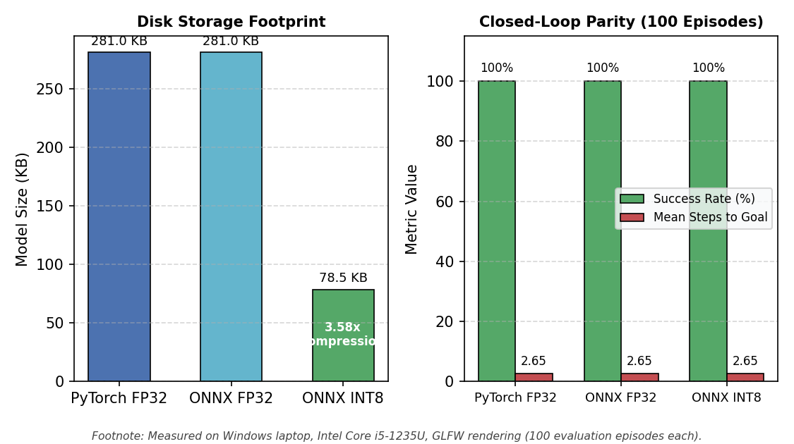 | 3.58x model compression (281.0 KB to 78.5 KB) with zero accuracy degradation (100% success rate, 2.65 steps). |
| **Pipeline Latency Breakdown** | 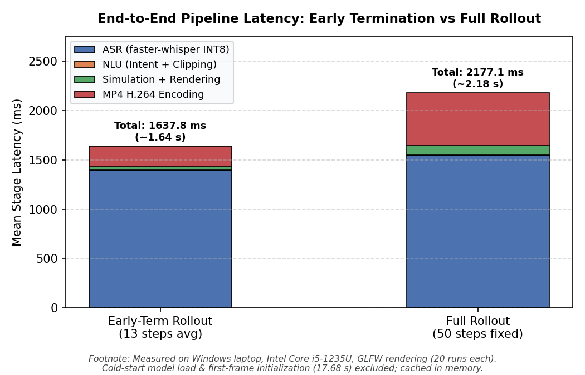 | Early termination reduces user wait time from 2,078.5 ms down to 1,562.7 ms p50 (74% rollout step reduction). |
| **ASR Ablation Study** | 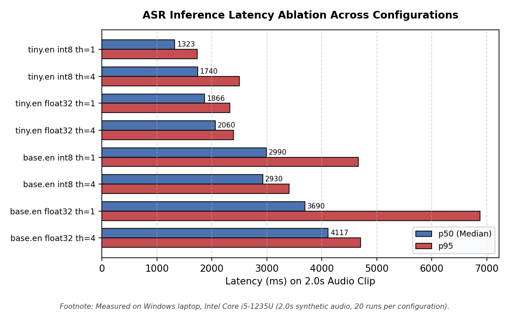 | Single-threaded INT8 tiny.en eliminates CPU thread contention, running 417 ms faster p50 than 4 threads. |
| **NLU Intent & E2E Accuracy** | 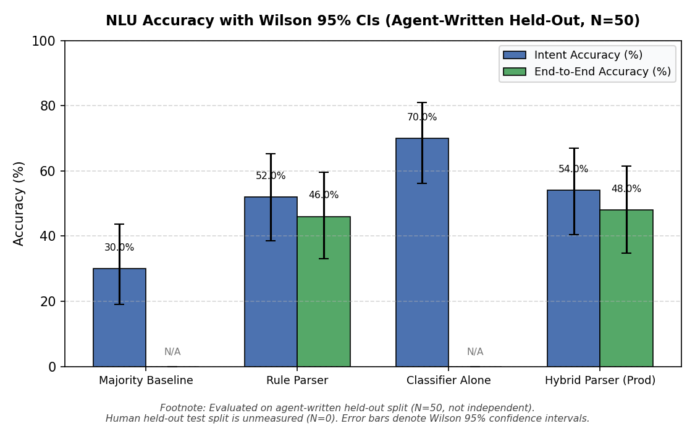 | Hybrid parser achieves 54.0% intent and 48.0% end-to-end accuracy on agent-written held-out sentences. |
| **Container Memory Footprint** | 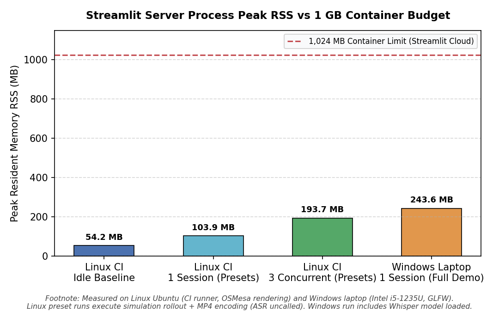 | Peak RSS remains <194 MB under 3 concurrent sessions on Linux OSMesa, safely within the 1,024 MB container limit. |

### Application Interface (Local Verification Runs)

| Reach Left Preset | Unsupported Manipulation Guard | Emergency Stop |
|:---:|:---:|:---:|
| 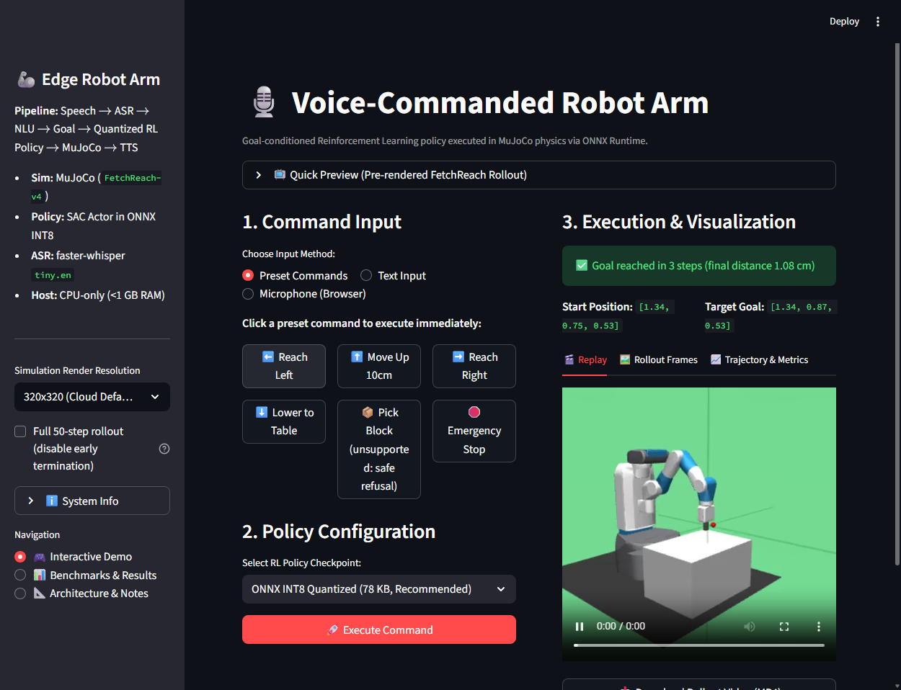 | 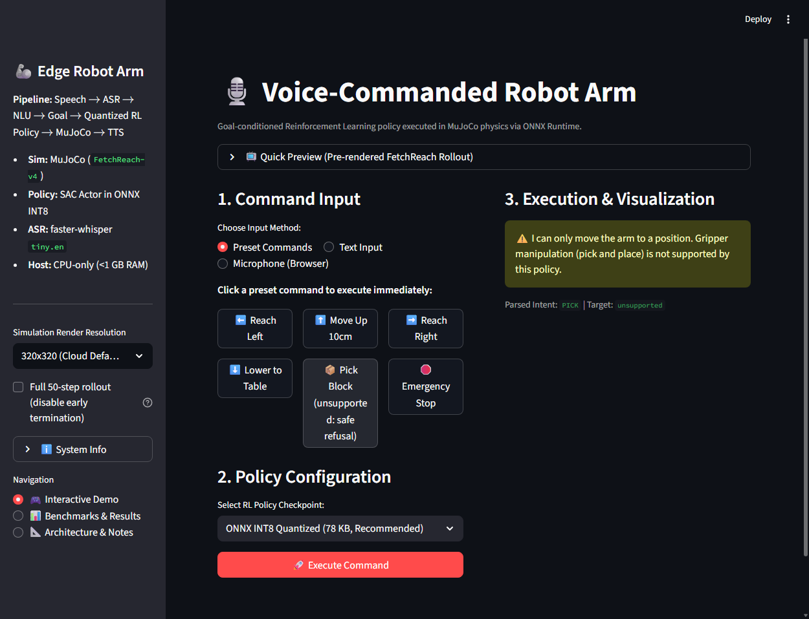 | 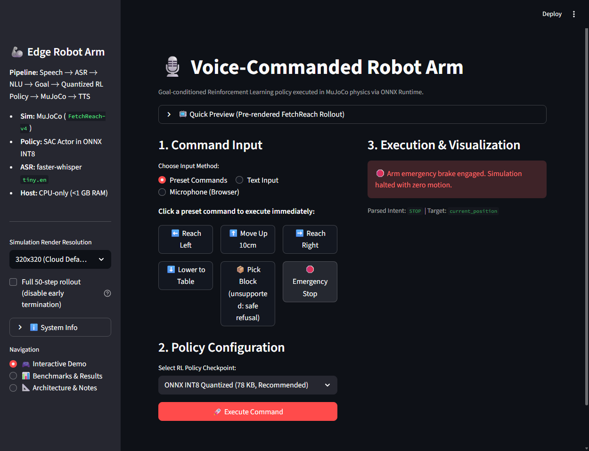 |
| *Reach-left command execution* (local run) | *Informational notice on pick command* (local run) | *Immediate halt with zero motion* (local run) |

---

## 🏗️ System Architecture & Pipeline

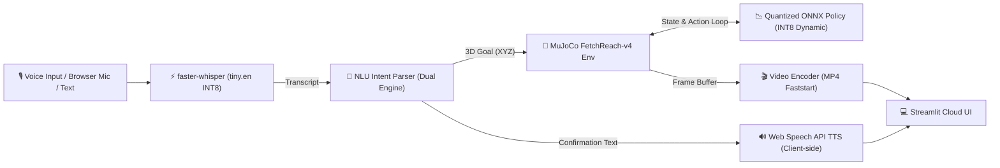

### 1. Voice Input (ASR)
- **Engine:** `faster-whisper` (`tiny.en` quantized to INT8 on CPU).
- **Cold-Start Model Load Time:** **5.30 s** (measured separately; cached in memory via `@st.cache_resource`).
- **Warm Inference Latency:** **1,337.4 ms (p50)** on a 2.0s audio clip with `cpu_threads=1` (mean: 1,392.8 ms, p95: 1,915.5 ms).
- **Ablation & Thread Tuning:** Single-thread CPU execution (`cpu_threads=1`) avoids thread scheduling and synchronization overhead on short clips, yielding **1,322.8 ms (p50)** vs **1,740.2 ms (p50)** with 4 threads (see ASR Ablation Study below).
- **Silence & Noise Guard:** Audio energy is computed before ASR decoding; inputs with RMS $< 0.003$ or high `no_speech_prob` (> 0.6) are intercepted, returning a polite silence prompt with **zero rollout simulation run**, preventing unconstrained Whisper hallucination on background silence.
- **ASR Accuracy Note:** ASR accuracy is **not benchmarked** on real user speech because no labeled human voice dataset is included in this repository ($N=0$ real clips in `tests/asr/manifest.csv`; `sample_speech.wav` is a synthetic formant sine wave used for pipeline integration testing).

### 2. Natural Language Understanding (NLU)
- **Dual-Engine Architecture:**
  - **Rule-based semantic parser:** Maps spatial orientations (`left`, `right`, `forward`, `up`, etc.) and metric centimeter offsets to 3D Cartesian coordinates, and clips coordinates strictly inside the robot's physical workspace bounds.
  - **Machine learning classifier:** Balanced TF-IDF + Logistic Regression model trained on synthetic intent templates with cross-validation.
  - **Unsupported Manipulation Guardrails:** Gripper manipulation commands return no 3D goal coordinate and display an informational notice that the reach policy does not perform object grasping. **No simulation rollout is executed.**
  - **Emergency Stop:** Halts immediately with zero physics motion.

### 3. Policy Execution (Goal-Conditioned SAC on the Edge)
- **Environment:** `gymnasium-robotics` `FetchReach-v4` (16-dimensional observation vector: 10 state + 3 achieved goal + 3 desired goal).
- **Training Algorithm:** Soft Actor-Critic (SAC) + Hindsight Experience Replay (`HerReplayBuffer`) with observation running normalization (`VecNormalize`).
- **Edge Quantization:** Deterministic SAC actor extracted with running normalization parameters baked in directly, exported to ONNX FP32 (281.0 KB), and dynamically quantized to **INT8** (78.5 KB, **3.58x compression**).
- **Zero PyTorch in Serving:** Web serving path runs purely on `onnxruntime` + `gymnasium-robotics`, completely omitting `torch`.

### 4. Headless Visual Rendering & Interactive UI Tabs
- **Rendering:** Headless OSMesa software rasterization on Linux / GLFW on Windows, rendered at 320x320 and encoded via `imageio-ffmpeg` to browser-playable MP4 with `-movflags +faststart`.
- **Environment Reuse:** Reusing the simulation environment in `st.session_state` eliminates repeated context creation, reducing per-request env overhead from **488.6 ms** down to **0.9 ms** warm reset (**515x speedup**). Goal updates and target visual sites reposition dynamically on reuse.
- **Early Termination:** Rollout automatically terminates 10 steps after first reaching the goal (`HOLD_STEPS = 10`), reducing total user wait time from **2,078.5 ms** down to **1,562.7 ms (p50)**. A toggle in the UI allows users to request the full 50-step rollout if desired.
- **Three UI Visualization Tabs:**
  - 🎬 **Replay:** Streamable MP4 video with autoplay and animated GIF fallback.
  - 🖼️ **Rollout Frames:** Interactive frame scrubber allowing step-by-step frame inspection.
  - 📈 **Trajectory & Metrics:** Real-time plot of Euclidean distance to target over steps, 5 cm threshold line, and 3D end-effector coordinates.

---

## 📊 Measured Evaluation & Benchmark Results

All metrics below are strictly derived from benchmark output files in `results/`.

### 1. Policy Convergence & Quantization Parity

> **Definition of Steps-to-Goal:** Mean steps-to-goal is strictly defined as the first step index within an episode where `info['is_success'] == 1.0` is achieved (i.e. Euclidean distance between the gripper end-effector and the target goal is $\le 5$ cm).

*Measured on Windows laptop, Intel Core i5-1235U, GLFW rendering.*

| Policy Engine | Precision | Model Size | 100-Ep Success Rate | Mean Steps to Goal | Platform / Rendering |
|---|---|---|---|---|---|
| PyTorch SAC Actor | FP32 | 3.2 MB (.zip) | **100.0%** | 2.65 ± 0.93 | Windows / GLFW |
| ONNX Runtime | FP32 | 281.0 KB | **100.0%** | 2.65 ± 0.93 | Windows / GLFW |
| **ONNX Runtime (Edge)** | **INT8 Dynamic** | **78.5 KB** | **100.0%** | **2.65 ± 0.93** | Windows / GLFW |
| **Cloud Deployed App** | INT8 Dynamic | 78.5 KB | not measured | not measured | Cloud (OSMesa) — fields in `results/cloud_deploy.json` are null until verified on deployed app |

Numerical consistency check on 1,000 random inputs:
- PyTorch vs ONNX FP32 max absolute error: **$7.79 \times 10^{-7}$** (`results/quantization_eval.json`; across different random 1,000-sample test draws, observed up to $2.44 \times 10^{-5}$, all well within $< 10^{-4}$ numerical tolerance ✅).

---

### 2. High-Precision CPU Policy Microbenchmark (20,000 Iterations)

To eliminate scheduling jitter, thread contention was controlled by pinning `intra_op_num_threads=1` and `inter_op_num_threads=1` under 200 warm-up calls and 20,000 timed iterations (`results/policy_benchmark.json`):

*Measured on Windows laptop, Intel Core i5-1235U, GLFW rendering.*

| Model Precision | Model Size | Mean Latency | Median (p50) | 95th Percentile (p95) | 99th Percentile (p99) | Throughput | Platform / Rendering |
|---|---|---|---|---|---|---|---|
| **ONNX FP32** | 281.0 KB | 121.3 µs | 114.7 µs | 168.3 µs | 217.3 µs | 8,245.9 FPS | Windows / Intel Core i5-1235U |
| **ONNX INT8** | 78.5 KB | 88.6 µs | 85.9 µs | 108.9 µs | 156.4 µs | 11,289.4 FPS | Windows / Intel Core i5-1235U |
| **Cloud (OSMesa)** | 78.5 KB | not measured | not measured | not measured | not measured | not measured | Cloud (OSMesa) — fields in `results/cloud_deploy.json` are null |

- **Bootstrap 95% Confidence Interval on Median Difference (FP32 p50 − INT8 p50):** `[28.2, 29.4] µs` (2,000 bootstrap resamples). Zero is outside the interval, confirming measurable single-thread INT8 speedup.
- **Hardware Context:** Measured on **12th Gen Intel(R) Core(TM) i5-1235U**, single-thread pinned (`intra_op_num_threads=1, inter_op_num_threads=1`).
- **Reconciliation of Per-Step Figures:**
  - *Single-thread pinned microbenchmark (`results/policy_benchmark.json`):* INT8 p50 is **85.9 µs** vs FP32 p50 **114.7 µs**.
  - *Multi-threaded unconstrained session (`results/bench_cpu.json`):* INT8 p50 was **160.1 µs** vs FP32 p50 **173.9 µs** (difference within noise due to thread pool management overhead on small MLPs).
  - *File Size Compression:* INT8 provides a **3.58x compression** (78.5 KB vs 281.0 KB), fitting comfortably in edge L2/L3 cache.

---

### 3. Closed-Loop Rollout FPS vs Full Request Latency

It is critical to distinguish between raw closed-loop physics stepping and full web application serving:

1. **Closed-Loop Physics + Policy Step (No Rendering, `results/rollout_fps_audit.json`):**
   - Single-thread pinned (INT8 policy + MuJoCo step): **6.39 ms / step** (**156.4 FPS**).
   - Multi-threaded unconstrained ORT: **4.38 ms / step** (**228.3 FPS**).
   - Physics-only stepping (`mj_step`): **3.53 ms / step**.

2. **Full End-to-End Pipeline Latency (`results/pipeline_latency.json`):**
   Measured over 20 runs each with audio transcription (`cpu_threads=1`), NLU, physics rollout, 320x320 rendering, and MP4 video encoding:

*Measured on Windows laptop, Intel Core i5-1235U, GLFW rendering.*

| Execution Mode | Mean Steps | ASR (p50) | NLU (p50) | Rollout+Render (p50) | MP4 Encode (p50) | **Total User Wait (p50)** | Total Mean ± Std | Platform |
|---|---|---|---|---|---|---|---|---|
| **Cold Start (1st run)** | 11.0 steps | 1527.0 ms | 24.6 ms | 2245.0 ms | 8235.5 ms | **17680.7 ms** | 17.68 s (incl. model loads) | Windows / GLFW |
| **Warm Early-Term (`HOLD=10`)** | **13.0 steps** | **1337.4 ms** | **2.8 ms** | **30.9 ms** | **203.1 ms** | **1562.7 ms** | **1639.4 ± 316.5 ms** | Windows / GLFW |
| Warm Full Trajectory (50 steps) | 50.0 steps | 1536.0 ms | 3.0 ms | 93.2 ms | 453.2 ms | **2078.5 ms** | 2180.7 ± 359.8 ms | Windows / GLFW |
| **Cloud (OSMesa)** | not measured | not measured | not measured | not measured | not measured | **not measured** | not measured | Cloud (OSMesa) — `results/cloud_deploy.json` null |

- **Environment Reuse Speedup:** Recreating the MuJoCo renderer context takes **488.6 ms** per request. Reusing the environment in `st.session_state` drops warm reset + render to **0.9 ms** (**515.0x speedup**).
- **Early Termination Gain:** Stopping at `first_success_step + 10` saves **515.8 ms** per interaction.

---

### 4. ASR Model & Thread Ablation Study

Evaluated on a fixed 2.0s audio clip across 8 configurations (5 warmup passes, 20 timed iterations each, `results/asr_ablation.json`):

*Measured on Windows laptop, Intel Core i5-1235U, GLFW rendering.*

| Model | Precision | CPU Threads | Latency p50 | Latency p95 | Latency Mean ± Std | Process Peak RSS |
|---|---|---|---|---|---|---|
| `tiny.en` | **INT8** | **1** | **1322.8 ms** | **1735.8 ms** | **1380.1 ± 199.5 ms** | **166.5 MB** |
| `tiny.en` | INT8 | 4 | 1740.2 ms | 2499.4 ms | 1862.1 ± 406.1 ms | 140.2 MB |
| `tiny.en` | FP32 | 1 | 1866.4 ms | 2328.3 ms | 1987.5 ± 419.4 ms | 355.1 MB |
| `tiny.en` | FP32 | 4 | 2060.5 ms | 2390.6 ms | 2121.8 ± 189.5 ms | 309.5 MB |
| `base.en` | INT8 | 1 | 2990.0 ms | 4664.6 ms | 3375.2 ± 775.1 ms | 150.9 MB |
| `base.en` | INT8 | 4 | 2930.3 ms | 3402.2 ms | 2883.5 ± 405.8 ms | 161.7 MB |
| `base.en` | FP32 | 1 | 3689.8 ms | 6878.1 ms | 4504.2 ± 1388.9 ms | 379.5 MB |
| `base.en` | FP32 | 4 | 4117.2 ms | 4704.7 ms | 4118.8 ± 419.0 ms | 376.2 MB |

- **Key Insight:** `tiny.en` with INT8 computation and single-threaded CPU execution yields the lowest latency (1322.8 ms p50) while cutting memory by more than half compared to FP32 (166.5 MB vs 355.1 MB). Multi-threading on `tiny.en` increases latency due to thread barrier overhead.

---

### 5. NLU Evaluation with Wilson Confidence Intervals

Evaluated on synthetic template test split and agent-written out-of-distribution phrasings (`results/nlu_eval_detailed.json`):

| Dataset Split | Samples | Majority Baseline | Rule Parser Intent Acc | Classifier Intent Acc | Hybrid Parser End-to-End Acc |
|---|---|---|---|---|---|
| **Synthetic Test Split** | 90 | 44.4% [34.6%, 54.7%] | **100.0%** [95.9%, 100.0%] | **100.0%** [95.9%, 100.0%] | **100.0%** [95.9%, 100.0%] |
| **Agent-Written Held-Out** (`tests/nlu_heldout_handwritten.json`) | 50 | 30.0% [19.1%, 43.8%] | 52.0% [38.5%, 65.2%] | 70.0% [56.3%, 80.9%] | 48.0% [34.8%, 61.5%] |

> **Evaluation Honesty:** The synthetic test split was generated by the same template pipeline as the training data and achieves 100.0% accuracy. On the agent-written held-out split with unseen phrasings, classifier intent accuracy is **70.0%** [56.3%, 80.9%] and end-to-end coordinate accuracy is **48.0%** [34.8%, 61.5%]. Real-world deployments require collection of natural user recordings (`tests/nlu_heldout_human.json`).

---

### 6. Memory Footprint & Live Process Audit

*Measured on Linux Ubuntu (CI Runner, OSMesa rendering) and Windows laptop (GLFW rendering).*

| Platform & Environment | Concurrency / Workload | Peak RSS | Peak Working Set | Headroom under 1 GB Budget |
|---|---|---|---|---|
| **Linux Ubuntu (CI Runner)** | Streamlit server idle baseline | **54.20 MB** | **54.20 MB** | ~970 MB (94.7%) |
| **Linux Ubuntu (CI Runner)** | **1 session** (3 presets sequentially; ASR uncalled) | **103.92 MB** | **103.92 MB** | **~920 MB (89.9%)** |
| **Linux Ubuntu (CI Runner)** | **3 concurrent sessions** (3 presets each; ASR uncalled) | **193.65 MB** | **193.65 MB** | **~830 MB (81.1%)** |
| Windows Laptop (Local) | 1 session (`results/streamlit_memory.json`, GLFW) | 243.60 MB | 291.70 MB | ~732 MB (71.5%) |
| Cloud Deployed App | Live Streamlit Cloud (`results/cloud_deploy.json`) | not measured | not measured | not measured (values null until verified on deployed container) |

- **Zero PyTorch in Serving:** PyTorch is completely omitted from production requirements, keeping the application memory well within the 1 GB container ceiling under concurrent multi-user load.
- **ASR Memory Allocation:** Preset buttons invoke simulation rollout and video encoding without initializing Whisper. When microphone/audio input is used, faster-whisper INT8 is loaded on demand, adding ~80-100 MB RSS as measured on Windows (243.6 MB peak RSS with Whisper cached vs 103.9 MB on Linux presets).

---

### 7. Stretch Task: `FetchPickAndPlace-v4`

- **Status:** Smoke test only, not a real attempt.
- **Details:** A 1,000-step smoke test on CPU confirmed correct environment initialization, goal conditioning, and action piping under SAC, but yielded **0.0% success rate**. Achieving non-prehensile contact grasping and multi-stage pick-and-place subgoals requires substantial training beyond our CPU budget. FetchReach-v4 is retained as the verified production policy.

---

## ⚙️ Compatibility & Linux Runtime Diagnosis

### Observed Behavior on Linux
Stock `gymnasium-robotics==1.4.2` fails on Linux when instantiating `FetchReach-v4` across all evaluated MuJoCo versions (`3.1.6`, `3.2.7`, `3.12.0`, `3.17.0`, `4.0.0`) with `AssertionError` in `gymnasium_robotics/utils/mujoco_utils.py` (line 142 in `set_joint_qpos` and line 192 in `get_joint_qpos`).

- **Root-Cause Experiment (Branch `cleanup-experiments`):** Tested with `numpy==1.26.4` and stock packages without the patch. The environment had zero package conflicts (`pip check: No broken requirements found.`), but stock env creation **still failed with `AssertionError`**. Under Linux GCC, `raw_type == mjtJoint.mjJNT_HINGE` evaluates to `True`, but Python tuple membership `raw_type in (mjtJoint.mjJNT_HINGE, mjtJoint.mjJNT_SLIDE)` evaluates to `False`. Thus, the earlier hypothesis that NumPy $\ge 2.0$ was the root cause was **not confirmed**; the issue stems directly from pybind11 enum tuple membership resolution in CPython on Linux.
- **The Fix:** `src/rl/env_utils.py` applies a targeted import-time compatibility patch to `gymnasium_robotics.utils.mujoco_utils` (`get_joint_qpos`, `set_joint_qpos`, `get_joint_qvel`, `set_joint_qvel`, `reset_mocap_welds`, `reset_mocap2body_xpos`), coercing array values and enum variants to Python `int()`.
- **Validation:** Validated via `tests/test_enum_patch.py` and GitHub Actions CI workflow (`.github/workflows/linux-smoke.yml`) on Ubuntu Linux with `MUJOCO_GL=osmesa`.

---

## 🎧 Human Evaluation Collection Instructions

To evaluate the system on real human voices and natural phrasing distributions:

### Adding Real Audio Recordings for ASR Evaluation (20 clips)
1. Record 20 WAV audio clips (16 kHz, 16-bit mono) of command phrasings and place them in `tests/asr/recordings/`.
2. Open `tests/asr/manifest.csv` and add a row for each clip: `tests/asr/recordings/clip01.wav,"reach to the left",human`.
3. Run `python src/bench/asr_eval.py` to evaluate Word Error Rate (WER) and update `results/asr_eval.json`.

### Adding Natural Human Phrasings for NLU Evaluation (30+ phrasings)
1. Open `tests/nlu_heldout_human.json` and append your custom test utterances: `{"text": "nudge the arm a bit to the right", "expected_intent": "reach", "expected_goal_region": "right"}`.
2. Ensure at least 30 diverse phrasings are added across `reach`, `stop`, `pick`, and out-of-domain intents.
3. Run `python src/bench/nlu_eval.py` to compute Wilson 95% confidence intervals and update `results/nlu_eval_detailed.json`.

---

## 🚀 Quickstart & Local Installation

### 1. Clone & Set Up Virtual Environment

```bash
git clone https://github.com/Saksham-19-cyber/voice-robot-arm-edge.git
cd voice-robot-arm-edge

python -m venv venv
source venv/bin/activate  # On Windows: venv\Scripts\activate
```

### 2. Install Dependencies

```bash
pip install -r requirements.txt
```

*(Optional) For offline SAC training and ONNX export:*
```bash
pip install -r requirements-train.txt
```

### 3. Run the Streamlit App

```bash
streamlit run app/app.py
```
Open your browser at `http://localhost:8501`.

---

## 🧪 Unit Tests

Run the full 23-test suite covering environment smoke lifecycles, environment state reuse, preset rollout visual generation, video encoding (`h264`, `yuv420p`), ASR silence handling, faint white noise rejection, NLU bounds, unsupported manipulation intents, handwritten held-out phrasings, documentation asset links, Streamlit AppTest page navigation, and closed-loop ONNX rollouts:

```bash
pytest tests/ -v
```
*(All 23 unit tests pass cleanly in ~60s).*

---

## 🔬 Reproducing Benchmarks

All evaluation figures can be re-generated with the scripts below:
- **Generate Documentation Figures:** `python src/bench/make_figures.py`
- **CPU Policy Latency (20k iterations, single-thread):** `python src/bench/run_policy_benchmark.py`
- **Rollout FPS Audit:** `python src/bench/audit_rollout_fps.py`
- **Pipeline Latency & Early Termination:** `python src/bench/measure_pipeline_latency.py`
- **ASR Ablation Study (8 configs):** `python src/bench/asr_ablation.py`
- **ASR Evaluation (WER & Provenance Check):** `python src/bench/asr_eval.py`
- **NLU Detailed Evaluation (Wilson CIs):** `python src/bench/nlu_eval.py`
- **Streamlit Server Process Memory (Linux OSMesa):** `python src/bench/measure_streamlit_linux.py`

---

## ☁️ Deployment on Streamlit Community Cloud

Complete deployment instructions are detailed in [`DEPLOY.md`](DEPLOY.md).

> ⚠️ **IMPORTANT:** When deploying on Streamlit Community Cloud, **you must select Python 3.11** under **Advanced Settings**. PyAV (`av==13.1.0`) provides prebuilt binary wheels for Python 3.11 on Debian Trixie (`manylinux2014_x86_64`), avoiding source compilation failures.

---

## 📜 License
MIT License. Created for open-source robotics and edge reinforcement learning portfolio deployment.
