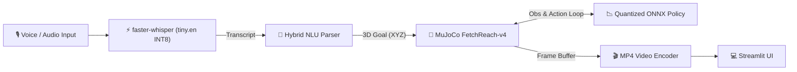

# Voice-Commanded Robot Arm with Quantized RL Policy on Edge

[](https://voice-robot-arm-edge-48q2t6rryznf97ypfkd59k.streamlit.app/)
[](https://www.python.org/)
[](https://opensource.org/licenses/MIT)
[-orange.svg)](https://onnxruntime.ai/)
[](tests/)

🔗 **Live Deployment:** [voice-robot-arm-edge-48q2t6rryznf97ypfkd59k.streamlit.app](https://voice-robot-arm-edge-48q2t6rryznf97ypfkd59k.streamlit.app/)

<!-- Placeholder for live Streamlit Cloud app screenshot: see assets/screenshots/ADD_CLOUD_SCREENSHOT.txt -->


An edge-ready robotics portfolio system translating spoken voice commands into 3D Cartesian goals and executing them with a goal-conditioned reinforcement learning (Soft Actor-Critic) policy inside MuJoCo physics. This implementation is scoped strictly to the FetchReach-v4 kinematic positioning task; multi-stage pick-and-place manipulation is not supported.

---

## ⚡ Key Benchmark Findings

All metrics come directly from `results/*.json` reproducibility artifacts.

1. **Model Compression & Parity:** Post-training dynamic INT8 quantization compresses the policy by 3.58x (281.0 KB FP32 &rarr; 78.5 KB INT8). Both FP32 and INT8 policies achieve 100.0% / 96.0% / 56.0% success within 5 cm / 2 cm / 1 cm thresholds (matching PyTorch FP32 at 100.0% / 96.0% / 54.0%; analytical proportional baseline: 100.0% / 98.0% / 91.0%, 0.18 cm final distance). *(Windows laptop, Intel Core i5-1235U; `results/quantization_eval.json`, `results/baseline_controller_eval.json`)*
2. **Policy Latency:** 3.58x smaller; no measurable latency difference on this CPU; run-to-run variation exceeds the difference; cause not profiled. (Direction: FP32 minus INT8, 5-run median difference: -6.0 µs, range [-17.2, 16.5] µs; repeated runs medians: 34.7 µs FP32 vs 42.6 µs INT8). *(Intel Core i5-1235U; `results/policy_benchmark.json`)*
3. **Simulation Speed & Breakdown:** Closed-loop rollout simulation runs at 580.2 FPS single-thread median (1.724 ms/step median; 609.6 FPS default threads); pure MuJoCo physics (20 substeps) takes 0.907 ms/step median. Step latency is dominated by physics (52.6%) and Gymnasium wrappers (38.1%); ONNX policy inference is 6.8% (closure diff 2.0%). *(Windows laptop, GLFW; `results/rollout_fps_audit.json`, `results/step_breakdown.json`)*
4. **Pipeline Latency & Env Reuse:** Early termination stops at first success + 10 hold steps (13.0 mean steps vs 50 max), yielding a warm user wait time of 1597.6 ms median (range [1220.7, 2008.5] ms across 5 runs). Caching the simulation environment in `st.session_state` delivers a 672.1x speedup (1.2 ms warm reset vs 394.7 ms cold recreation). *(Windows laptop, GLFW; `results/pipeline_latency.json`)*
5. **NLU Accuracy & Memory:** Hybrid parser achieves 100.0% intent/e2e on template split (tuned, not held-out, N=80) and 76.0% intent / 68.0% e2e on agent-written dev set (N=50). Server RSS:
   - **Linux CI (OSMesa):** 54.28 MB idle server baseline, 185.59 MB peak RSS across 3 concurrent sessions each executing 3 presets and 1 real transcription (`results/streamlit_memory_v4.json`).
   - **Windows Laptop (GLFW):** 127.1 MB idle connected server baseline, 205.1 MB peak RSS (+78.0 MB attributable ASR model cache delta) (`results/streamlit_memory_v3.json`).
   Both environments provide >80% headroom under 1 GB container limits.

---

## 📊 Empirical Visualizations

### Model Parity & Size


### End-to-End Pipeline Latency Breakdown


### Server Process Memory by Operating System


### NLU Dual-Engine Accuracy & Confidence Intervals


---

## 🏗️ System Architecture



---

## 🚀 Quickstart

```bash
git clone https://github.com/Saksham-19-cyber/voice-robot-arm-edge.git
cd voice-robot-arm-edge
python -m venv venv

# Linux / macOS:
source venv/bin/activate
# Windows:
# .\venv\Scripts\activate

pip install -r requirements.txt
streamlit run app/app.py
```

---

## ☁️ Cloud Measurements & Limitations

- **Cloud measurements:** pending (`results/cloud_deploy.json`)
- **Kinematic reach only:** `FetchReach-v4` is solved (100.0% success). Multi-stage manipulation is unsupported (`FetchPickAndPlace-v4` exploratory run: 0.0% success at 1,000 steps; `results/stretch_eval.json`).
- **ASR accuracy:** Not benchmarked on real human voice recordings ($N=0$ real clips; `sample_speech.wav` is a synthetic integration test fixture; `results/asr_eval.json`).
- **NLU generalization:** `tests/nlu_dev_agent_written.json` is a dev set tuned during inspection. Only `tests/nlu_heldout_human.json` counts as held-out ($N=0$, unbenchmarked).
- **GPU hardware:** Not measured on physical NVIDIA Jetson hardware; all repo benchmarks executed on CPU.

---

## 📖 Extended Technical Documentation

- 📋 [Change log](docs/AUDIT_LOG.md)
- 🔬 [Verified Technical Claims Provenance Table](docs/VERIFIED_CLAIMS.md)
- 📈 [Detailed Empirical Benchmarks & Tables](docs/BENCHMARKS.md)
- 🚀 [Production Deployment Guide](DEPLOY.md)
